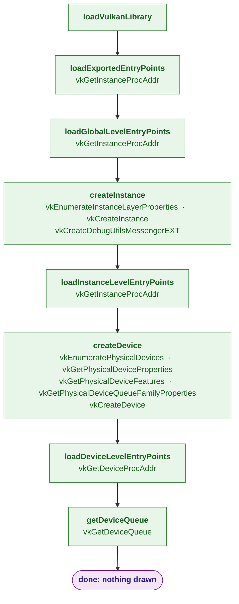

# Tutorial01 — Device initialization

[Index](../vulkan_pipeline_breakdown.md) · Builds on: nothing ·
Next: [Tutorial02](02_swap_chain.md)

Loads Vulkan, creates an instance and a logical device, and fetches one
queue. No window surface, no swapchain, nothing drawn. `Tutorial01`
derives from `os::ProjectBase` directly; [`TutorialBase`](tutorialbase.md)
later absorbs these steps.

| Step | From | Vulkan calls |
|---|---|---|
| **loadVulkanLibrary** | new here | — |
| **loadExportedEntryPoints** | new here | [vkGetInstanceProcAddr](https://registry.khronos.org/vulkan/specs/latest/man/html/vkGetInstanceProcAddr.html) |
| **loadGlobalLevelEntryPoints** | new here | [vkGetInstanceProcAddr](https://registry.khronos.org/vulkan/specs/latest/man/html/vkGetInstanceProcAddr.html) |
| **createInstance** | new here | [vkEnumerateInstanceLayerProperties](https://registry.khronos.org/vulkan/specs/latest/man/html/vkEnumerateInstanceLayerProperties.html), [vkCreateInstance](https://registry.khronos.org/vulkan/specs/latest/man/html/vkCreateInstance.html), [vkCreateDebugUtilsMessengerEXT](https://registry.khronos.org/vulkan/specs/latest/man/html/vkCreateDebugUtilsMessengerEXT.html) |
| **loadInstanceLevelEntryPoints** | new here | [vkGetInstanceProcAddr](https://registry.khronos.org/vulkan/specs/latest/man/html/vkGetInstanceProcAddr.html) |
| **createDevice** | new here | [vkEnumeratePhysicalDevices](https://registry.khronos.org/vulkan/specs/latest/man/html/vkEnumeratePhysicalDevices.html), [vkGetPhysicalDeviceProperties](https://registry.khronos.org/vulkan/specs/latest/man/html/vkGetPhysicalDeviceProperties.html), [vkGetPhysicalDeviceFeatures](https://registry.khronos.org/vulkan/specs/latest/man/html/vkGetPhysicalDeviceFeatures.html), [vkGetPhysicalDeviceQueueFamilyProperties](https://registry.khronos.org/vulkan/specs/latest/man/html/vkGetPhysicalDeviceQueueFamilyProperties.html), [vkCreateDevice](https://registry.khronos.org/vulkan/specs/latest/man/html/vkCreateDevice.html) |
| **loadDeviceLevelEntryPoints** | new here | [vkGetDeviceProcAddr](https://registry.khronos.org/vulkan/specs/latest/man/html/vkGetDeviceProcAddr.html) |
| **getDeviceQueue** | new here | [vkGetDeviceQueue](https://registry.khronos.org/vulkan/specs/latest/man/html/vkGetDeviceQueue.html) |
| **done: nothing drawn** | this tutorial | — |

## What's new

Everything; this is the starting point. The function-pointer loading
pattern (`ListOfFunctions.inl` + `VulkanFunctions.h`) is what the
fault-injection tests later swap out.

Source: `bin/01_device_initialization/Tutorial01.cpp`
