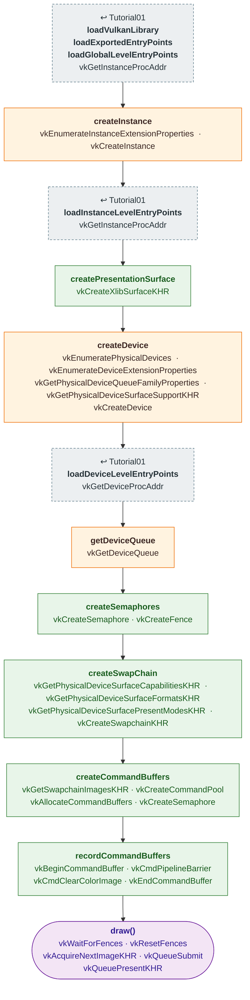

# Tutorial02 — Swapchain and a cleared window

[Index](../vulkan_pipeline_breakdown.md) · Builds on:
[Tutorial01](01_device_initialization.md) · Next:
[Tutorial03](03_first_triangle.md)

Opens an X11 window, presents to it, and fills each swapchain image with a
solid color using a transfer command. There is no render pass, pipeline,
or shader yet.

| Step | From | Vulkan calls |
|---|---|---|
| **loadVulkanLibrary · loadExportedEntryPoints · loadGlobalLevelEntryPoints** | [Tutorial01](01_device_initialization.md) | [vkGetInstanceProcAddr](https://registry.khronos.org/vulkan/specs/latest/man/html/vkGetInstanceProcAddr.html) |
| **createInstance** | changed here | [vkEnumerateInstanceExtensionProperties](https://registry.khronos.org/vulkan/specs/latest/man/html/vkEnumerateInstanceExtensionProperties.html), [vkCreateInstance](https://registry.khronos.org/vulkan/specs/latest/man/html/vkCreateInstance.html) |
| **loadInstanceLevelEntryPoints** | [Tutorial01](01_device_initialization.md) | [vkGetInstanceProcAddr](https://registry.khronos.org/vulkan/specs/latest/man/html/vkGetInstanceProcAddr.html) |
| **createPresentationSurface** | new here | [vkCreateXlibSurfaceKHR](https://registry.khronos.org/vulkan/specs/latest/man/html/vkCreateXlibSurfaceKHR.html) |
| **createDevice** | changed here | [vkEnumeratePhysicalDevices](https://registry.khronos.org/vulkan/specs/latest/man/html/vkEnumeratePhysicalDevices.html), [vkEnumerateDeviceExtensionProperties](https://registry.khronos.org/vulkan/specs/latest/man/html/vkEnumerateDeviceExtensionProperties.html), [vkGetPhysicalDeviceQueueFamilyProperties](https://registry.khronos.org/vulkan/specs/latest/man/html/vkGetPhysicalDeviceQueueFamilyProperties.html), [vkGetPhysicalDeviceSurfaceSupportKHR](https://registry.khronos.org/vulkan/specs/latest/man/html/vkGetPhysicalDeviceSurfaceSupportKHR.html), [vkCreateDevice](https://registry.khronos.org/vulkan/specs/latest/man/html/vkCreateDevice.html) |
| **loadDeviceLevelEntryPoints** | [Tutorial01](01_device_initialization.md) | [vkGetDeviceProcAddr](https://registry.khronos.org/vulkan/specs/latest/man/html/vkGetDeviceProcAddr.html) |
| **getDeviceQueue** | changed here | [vkGetDeviceQueue](https://registry.khronos.org/vulkan/specs/latest/man/html/vkGetDeviceQueue.html) |
| **createSemaphores** | new here | [vkCreateSemaphore](https://registry.khronos.org/vulkan/specs/latest/man/html/vkCreateSemaphore.html), [vkCreateFence](https://registry.khronos.org/vulkan/specs/latest/man/html/vkCreateFence.html) |
| **createSwapChain** | new here | [vkGetPhysicalDeviceSurfaceCapabilitiesKHR](https://registry.khronos.org/vulkan/specs/latest/man/html/vkGetPhysicalDeviceSurfaceCapabilitiesKHR.html), [vkGetPhysicalDeviceSurfaceFormatsKHR](https://registry.khronos.org/vulkan/specs/latest/man/html/vkGetPhysicalDeviceSurfaceFormatsKHR.html), [vkGetPhysicalDeviceSurfacePresentModesKHR](https://registry.khronos.org/vulkan/specs/latest/man/html/vkGetPhysicalDeviceSurfacePresentModesKHR.html), [vkCreateSwapchainKHR](https://registry.khronos.org/vulkan/specs/latest/man/html/vkCreateSwapchainKHR.html) |
| **createCommandBuffers** | new here | [vkGetSwapchainImagesKHR](https://registry.khronos.org/vulkan/specs/latest/man/html/vkGetSwapchainImagesKHR.html), [vkCreateCommandPool](https://registry.khronos.org/vulkan/specs/latest/man/html/vkCreateCommandPool.html), [vkAllocateCommandBuffers](https://registry.khronos.org/vulkan/specs/latest/man/html/vkAllocateCommandBuffers.html), [vkCreateSemaphore](https://registry.khronos.org/vulkan/specs/latest/man/html/vkCreateSemaphore.html) |
| **recordCommandBuffers** | new here | [vkBeginCommandBuffer](https://registry.khronos.org/vulkan/specs/latest/man/html/vkBeginCommandBuffer.html), [vkCmdPipelineBarrier](https://registry.khronos.org/vulkan/specs/latest/man/html/vkCmdPipelineBarrier.html), [vkCmdClearColorImage](https://registry.khronos.org/vulkan/specs/latest/man/html/vkCmdClearColorImage.html), [vkEndCommandBuffer](https://registry.khronos.org/vulkan/specs/latest/man/html/vkEndCommandBuffer.html) |
| **draw()** | this tutorial | [vkWaitForFences](https://registry.khronos.org/vulkan/specs/latest/man/html/vkWaitForFences.html), [vkResetFences](https://registry.khronos.org/vulkan/specs/latest/man/html/vkResetFences.html), [vkAcquireNextImageKHR](https://registry.khronos.org/vulkan/specs/latest/man/html/vkAcquireNextImageKHR.html), [vkQueueSubmit](https://registry.khronos.org/vulkan/specs/latest/man/html/vkQueueSubmit.html), [vkQueuePresentKHR](https://registry.khronos.org/vulkan/specs/latest/man/html/vkQueuePresentKHR.html) |

## What's new

- A window surface and a device that can present to it, possibly from a
  different queue family than graphics.
- The swapchain, recreated by `onWindowSizeChanged()`.
- Pre-recorded command buffers, one per swapchain image.
- The clear is a transfer command. From Tutorial03 on, a render pass
  `loadOp` does it instead.

Source: `bin/02_swap_chain/Tutorial02.cpp`
