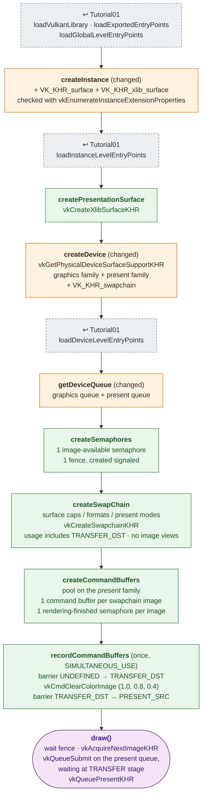

# Tutorial02 — Swapchain and a cleared window

[Index](../vulkan_pipeline_breakdown.md) · Builds on:
[Tutorial01](01_device_initialization.md) · Next:
[Tutorial03](03_first_triangle.md)

Opens an X11 window, presents to it, and fills each swapchain image with a
solid color using a transfer command. There is no render pass, pipeline,
or shader yet.

**Linked steps:** loading and instance-level entry points come from
[Tutorial01](01_device_initialization.md).

## What's new

- A window surface and a device that can present to it, possibly from a
  different queue family than graphics.
- The swapchain, recreated by `onWindowSizeChanged()`.
- Pre-recorded command buffers, one per swapchain image.
- The clear is a transfer command. From Tutorial03 on, a render pass
  `loadOp` does it instead.

## Spec links

[`vkCreateXlibSurfaceKHR`](https://registry.khronos.org/vulkan/specs/latest/man/html/vkCreateXlibSurfaceKHR.html) ·
[`vkGetPhysicalDeviceSurfaceSupportKHR`](https://registry.khronos.org/vulkan/specs/latest/man/html/vkGetPhysicalDeviceSurfaceSupportKHR.html) ·
[`vkCreateSwapchainKHR`](https://registry.khronos.org/vulkan/specs/latest/man/html/vkCreateSwapchainKHR.html) ·
[`vkCmdClearColorImage`](https://registry.khronos.org/vulkan/specs/latest/man/html/vkCmdClearColorImage.html) ·
[`vkAcquireNextImageKHR`](https://registry.khronos.org/vulkan/specs/latest/man/html/vkAcquireNextImageKHR.html) ·
[`vkQueuePresentKHR`](https://registry.khronos.org/vulkan/specs/latest/man/html/vkQueuePresentKHR.html)

Source: `bin/02_swap_chain/Tutorial02.cpp`
