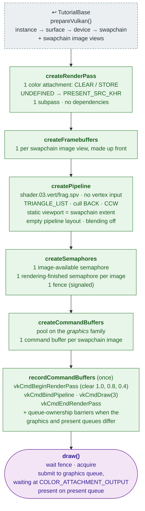

# Tutorial03 — First triangle

[Index](../vulkan_pipeline_breakdown.md) · Builds on:
[Tutorial02](02_swap_chain.md) via [TutorialBase](tutorialbase.md) ·
Next: [Tutorial04](04_vertex_attributes.md)

The first real graphics pipeline: a render pass, framebuffers, and SPIR-V
shaders. The vertex shader makes the triangle's three corners from
`gl_VertexIndex`, so there is no vertex buffer.

**Linked steps:** device and swapchain setup is
[TutorialBase](tutorialbase.md), which packages
[Tutorial01](01_device_initialization.md) and
[Tutorial02](02_swap_chain.md).

## What's new

- Render pass with `loadOp = CLEAR`; the clear no longer needs a transfer
  command.
- Framebuffers over the swapchain image views.
- Shader modules (`VulkanCommon::createShaderModule()`) and the first
  `VkPipeline`.
- Command pool moves from the present family to the graphics family.

## Spec links

[`vkCreateRenderPass`](https://registry.khronos.org/vulkan/specs/latest/man/html/vkCreateRenderPass.html) ·
[`vkCreateFramebuffer`](https://registry.khronos.org/vulkan/specs/latest/man/html/vkCreateFramebuffer.html) ·
[`vkCreateShaderModule`](https://registry.khronos.org/vulkan/specs/latest/man/html/vkCreateShaderModule.html) ·
[`vkCreatePipelineLayout`](https://registry.khronos.org/vulkan/specs/latest/man/html/vkCreatePipelineLayout.html) ·
[`vkCreateGraphicsPipelines`](https://registry.khronos.org/vulkan/specs/latest/man/html/vkCreateGraphicsPipelines.html) ·
[`vkCmdBeginRenderPass`](https://registry.khronos.org/vulkan/specs/latest/man/html/vkCmdBeginRenderPass.html) ·
[`vkCmdDraw`](https://registry.khronos.org/vulkan/specs/latest/man/html/vkCmdDraw.html)

Source: `bin/03_first_triangle/Tutorial03.cpp`
