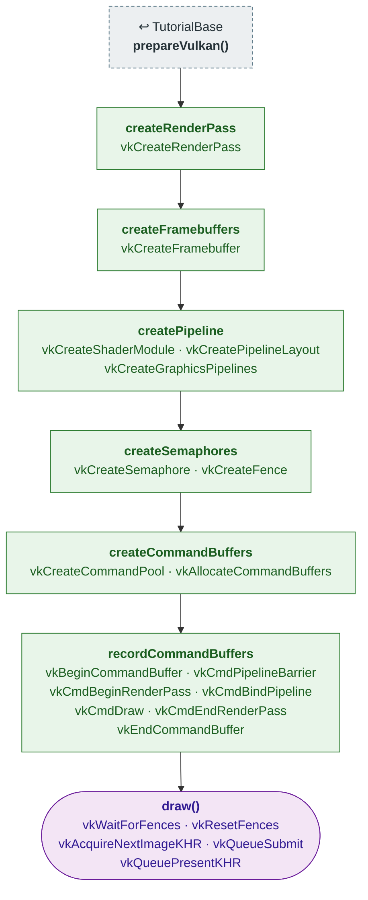

# Tutorial03 — First triangle

[Index](../vulkan_pipeline_breakdown.md) · Builds on:
[Tutorial02](02_swap_chain.md) via [TutorialBase](tutorialbase.md) ·
Next: [Tutorial04](04_vertex_attributes.md)

The first real graphics pipeline: a render pass, framebuffers, and SPIR-V
shaders. The vertex shader makes the triangle's three corners from
`gl_VertexIndex`, so there is no vertex buffer.

| Step | From | Vulkan calls |
|---|---|---|
| **prepareVulkan()** | [TutorialBase](tutorialbase.md) | — |
| **createRenderPass** | new here | [vkCreateRenderPass](https://registry.khronos.org/vulkan/specs/latest/man/html/vkCreateRenderPass.html) |
| **createFramebuffers** | new here | [vkCreateFramebuffer](https://registry.khronos.org/vulkan/specs/latest/man/html/vkCreateFramebuffer.html) |
| **createPipeline** | new here | [vkCreateShaderModule](https://registry.khronos.org/vulkan/specs/latest/man/html/vkCreateShaderModule.html), [vkCreatePipelineLayout](https://registry.khronos.org/vulkan/specs/latest/man/html/vkCreatePipelineLayout.html), [vkCreateGraphicsPipelines](https://registry.khronos.org/vulkan/specs/latest/man/html/vkCreateGraphicsPipelines.html) |
| **createSemaphores** | new here | [vkCreateSemaphore](https://registry.khronos.org/vulkan/specs/latest/man/html/vkCreateSemaphore.html), [vkCreateFence](https://registry.khronos.org/vulkan/specs/latest/man/html/vkCreateFence.html) |
| **createCommandBuffers** | new here | [vkCreateCommandPool](https://registry.khronos.org/vulkan/specs/latest/man/html/vkCreateCommandPool.html), [vkAllocateCommandBuffers](https://registry.khronos.org/vulkan/specs/latest/man/html/vkAllocateCommandBuffers.html) |
| **recordCommandBuffers** | new here | [vkBeginCommandBuffer](https://registry.khronos.org/vulkan/specs/latest/man/html/vkBeginCommandBuffer.html), [vkCmdPipelineBarrier](https://registry.khronos.org/vulkan/specs/latest/man/html/vkCmdPipelineBarrier.html), [vkCmdBeginRenderPass](https://registry.khronos.org/vulkan/specs/latest/man/html/vkCmdBeginRenderPass.html), [vkCmdBindPipeline](https://registry.khronos.org/vulkan/specs/latest/man/html/vkCmdBindPipeline.html), [vkCmdDraw](https://registry.khronos.org/vulkan/specs/latest/man/html/vkCmdDraw.html), [vkCmdEndRenderPass](https://registry.khronos.org/vulkan/specs/latest/man/html/vkCmdEndRenderPass.html), [vkEndCommandBuffer](https://registry.khronos.org/vulkan/specs/latest/man/html/vkEndCommandBuffer.html) |
| **draw()** | this tutorial | [vkWaitForFences](https://registry.khronos.org/vulkan/specs/latest/man/html/vkWaitForFences.html), [vkResetFences](https://registry.khronos.org/vulkan/specs/latest/man/html/vkResetFences.html), [vkAcquireNextImageKHR](https://registry.khronos.org/vulkan/specs/latest/man/html/vkAcquireNextImageKHR.html), [vkQueueSubmit](https://registry.khronos.org/vulkan/specs/latest/man/html/vkQueueSubmit.html), [vkQueuePresentKHR](https://registry.khronos.org/vulkan/specs/latest/man/html/vkQueuePresentKHR.html) |

Also builds on: [Tutorial01](01_device_initialization.md), [Tutorial02](02_swap_chain.md).

## What's new

- Render pass with `loadOp = CLEAR`; the clear no longer needs a transfer
  command.
- Framebuffers over the swapchain image views.
- Shader modules (`VulkanCommon::createShaderModule()`) and the first
  `VkPipeline`.
- Command pool moves from the present family to the graphics family.

Source: `bin/03_first_triangle/Tutorial03.cpp`
