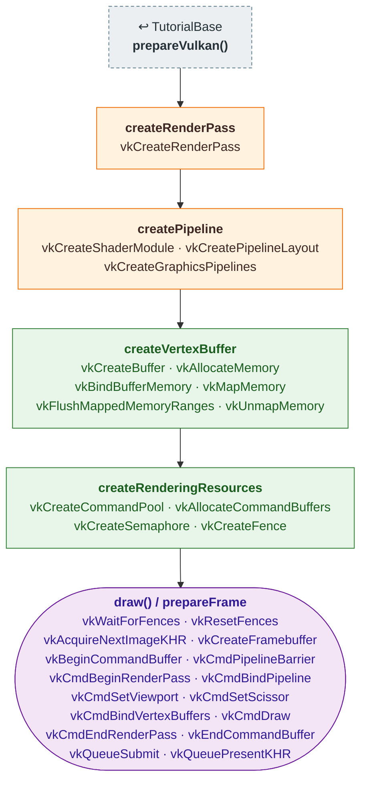

# Tutorial04 — Vertex attributes

[Index](../vulkan_pipeline_breakdown.md) · Builds on:
[Tutorial03](03_first_triangle.md) · Next:
[Tutorial05](05_staging_resources.md)

Draws a colored quad from a vertex buffer, and replaces Tutorial03's
pre-recorded command buffers with a per-frame loop over three frames in
flight. Tutorial05–10 keep this loop.

| Step | From | Vulkan calls |
|---|---|---|
| **prepareVulkan()** | [TutorialBase](tutorialbase.md) | — |
| **createRenderPass** | changed here | [vkCreateRenderPass](https://registry.khronos.org/vulkan/specs/latest/man/html/vkCreateRenderPass.html) |
| **createPipeline** | changed here | [vkCreateShaderModule](https://registry.khronos.org/vulkan/specs/latest/man/html/vkCreateShaderModule.html), [vkCreatePipelineLayout](https://registry.khronos.org/vulkan/specs/latest/man/html/vkCreatePipelineLayout.html), [vkCreateGraphicsPipelines](https://registry.khronos.org/vulkan/specs/latest/man/html/vkCreateGraphicsPipelines.html) |
| **createVertexBuffer** | new here | [vkCreateBuffer](https://registry.khronos.org/vulkan/specs/latest/man/html/vkCreateBuffer.html), [vkAllocateMemory](https://registry.khronos.org/vulkan/specs/latest/man/html/vkAllocateMemory.html), [vkBindBufferMemory](https://registry.khronos.org/vulkan/specs/latest/man/html/vkBindBufferMemory.html), [vkMapMemory](https://registry.khronos.org/vulkan/specs/latest/man/html/vkMapMemory.html), [vkFlushMappedMemoryRanges](https://registry.khronos.org/vulkan/specs/latest/man/html/vkFlushMappedMemoryRanges.html), [vkUnmapMemory](https://registry.khronos.org/vulkan/specs/latest/man/html/vkUnmapMemory.html) |
| **createRenderingResources** | new here | [vkCreateCommandPool](https://registry.khronos.org/vulkan/specs/latest/man/html/vkCreateCommandPool.html), [vkAllocateCommandBuffers](https://registry.khronos.org/vulkan/specs/latest/man/html/vkAllocateCommandBuffers.html), [vkCreateSemaphore](https://registry.khronos.org/vulkan/specs/latest/man/html/vkCreateSemaphore.html), [vkCreateFence](https://registry.khronos.org/vulkan/specs/latest/man/html/vkCreateFence.html) |
| **draw() / prepareFrame** | this tutorial | [vkWaitForFences](https://registry.khronos.org/vulkan/specs/latest/man/html/vkWaitForFences.html), [vkResetFences](https://registry.khronos.org/vulkan/specs/latest/man/html/vkResetFences.html), [vkAcquireNextImageKHR](https://registry.khronos.org/vulkan/specs/latest/man/html/vkAcquireNextImageKHR.html), [vkCreateFramebuffer](https://registry.khronos.org/vulkan/specs/latest/man/html/vkCreateFramebuffer.html), [vkBeginCommandBuffer](https://registry.khronos.org/vulkan/specs/latest/man/html/vkBeginCommandBuffer.html), [vkCmdPipelineBarrier](https://registry.khronos.org/vulkan/specs/latest/man/html/vkCmdPipelineBarrier.html), [vkCmdBeginRenderPass](https://registry.khronos.org/vulkan/specs/latest/man/html/vkCmdBeginRenderPass.html), [vkCmdBindPipeline](https://registry.khronos.org/vulkan/specs/latest/man/html/vkCmdBindPipeline.html), [vkCmdSetViewport](https://registry.khronos.org/vulkan/specs/latest/man/html/vkCmdSetViewport.html), [vkCmdSetScissor](https://registry.khronos.org/vulkan/specs/latest/man/html/vkCmdSetScissor.html), [vkCmdBindVertexBuffers](https://registry.khronos.org/vulkan/specs/latest/man/html/vkCmdBindVertexBuffers.html), [vkCmdDraw](https://registry.khronos.org/vulkan/specs/latest/man/html/vkCmdDraw.html), [vkCmdEndRenderPass](https://registry.khronos.org/vulkan/specs/latest/man/html/vkCmdEndRenderPass.html), [vkEndCommandBuffer](https://registry.khronos.org/vulkan/specs/latest/man/html/vkEndCommandBuffer.html), [vkQueueSubmit](https://registry.khronos.org/vulkan/specs/latest/man/html/vkQueueSubmit.html), [vkQueuePresentKHR](https://registry.khronos.org/vulkan/specs/latest/man/html/vkQueuePresentKHR.html) |

Also builds on: [page](03_first_triangle.md).

## What's new

- Vertex input state and a host-visible vertex buffer.
- Frames in flight: three sets of command buffer, semaphore, and fence,
  re-recorded every frame (`VK_COMMAND_BUFFER_USAGE_ONE_TIME_SUBMIT_BIT`).
- The framebuffer is made at record time for the acquired image.
- Viewport and scissor are dynamic state, so a resize doesn't require a
  new pipeline for them.

Source: `bin/04_vertex_attributes/Tutorial04.cpp`
