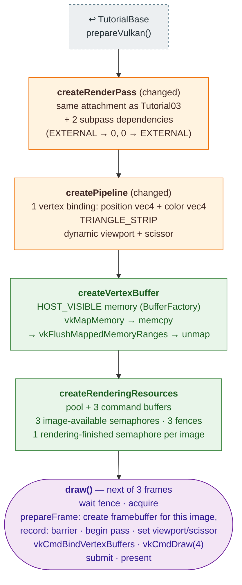

# Tutorial04 — Vertex attributes

[Index](../vulkan_pipeline_breakdown.md) · Builds on:
[Tutorial03](03_first_triangle.md) · Next:
[Tutorial05](05_staging_resources.md)

Draws a colored quad from a vertex buffer, and replaces Tutorial03's
pre-recorded command buffers with a per-frame loop over three frames in
flight. Tutorial05–10 keep this loop.

**Linked steps:** [TutorialBase](tutorialbase.md). The render pass and
pipeline are Tutorial03's ([page](03_first_triangle.md)) with the changes
above.

## What's new

- Vertex input state and a host-visible vertex buffer.
- Frames in flight: three sets of command buffer, semaphore, and fence,
  re-recorded every frame (`VK_COMMAND_BUFFER_USAGE_ONE_TIME_SUBMIT_BIT`).
- The framebuffer is made at record time for the acquired image.
- Viewport and scissor are dynamic state, so a resize doesn't require a
  new pipeline for them.

## Spec links

[`VkVertexInputAttributeDescription`](https://registry.khronos.org/vulkan/specs/latest/man/html/VkVertexInputAttributeDescription.html) ·
[`VkSubpassDependency`](https://registry.khronos.org/vulkan/specs/latest/man/html/VkSubpassDependency.html) ·
[`vkMapMemory`](https://registry.khronos.org/vulkan/specs/latest/man/html/vkMapMemory.html) ·
[`vkFlushMappedMemoryRanges`](https://registry.khronos.org/vulkan/specs/latest/man/html/vkFlushMappedMemoryRanges.html) ·
[`vkCmdBindVertexBuffers`](https://registry.khronos.org/vulkan/specs/latest/man/html/vkCmdBindVertexBuffers.html) ·
[`vkCmdSetViewport`](https://registry.khronos.org/vulkan/specs/latest/man/html/vkCmdSetViewport.html)

Source: `bin/04_vertex_attributes/Tutorial04.cpp`
