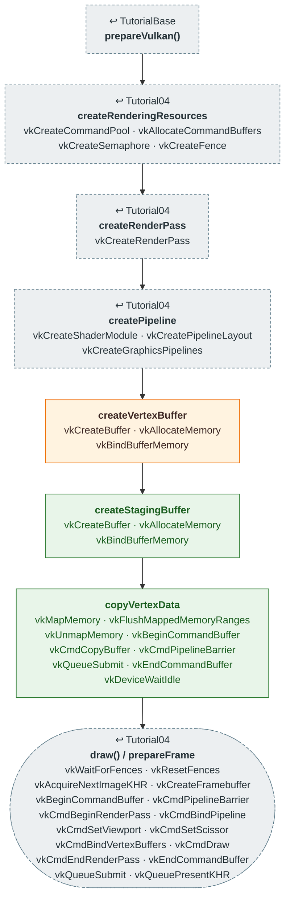

# Tutorial05 — Staging resources

[Index](../vulkan_pipeline_breakdown.md) · Builds on:
[Tutorial04](04_vertex_attributes.md) · Next:
[Tutorial06](06_descriptor_sets.md)

Same quad and same shaders as Tutorial04, but the vertex buffer lives in
device-local memory and is filled through a staging buffer.

| Step | From | Vulkan calls |
|---|---|---|
| **prepareVulkan()** | [TutorialBase](tutorialbase.md) | — |
| **createRenderingResources** | [Tutorial04](04_vertex_attributes.md) | [vkCreateCommandPool](https://registry.khronos.org/vulkan/specs/latest/man/html/vkCreateCommandPool.html), [vkAllocateCommandBuffers](https://registry.khronos.org/vulkan/specs/latest/man/html/vkAllocateCommandBuffers.html), [vkCreateSemaphore](https://registry.khronos.org/vulkan/specs/latest/man/html/vkCreateSemaphore.html), [vkCreateFence](https://registry.khronos.org/vulkan/specs/latest/man/html/vkCreateFence.html) |
| **createRenderPass** | [Tutorial04](04_vertex_attributes.md) | [vkCreateRenderPass](https://registry.khronos.org/vulkan/specs/latest/man/html/vkCreateRenderPass.html) |
| **createPipeline** | [Tutorial04](04_vertex_attributes.md) | [vkCreateShaderModule](https://registry.khronos.org/vulkan/specs/latest/man/html/vkCreateShaderModule.html), [vkCreatePipelineLayout](https://registry.khronos.org/vulkan/specs/latest/man/html/vkCreatePipelineLayout.html), [vkCreateGraphicsPipelines](https://registry.khronos.org/vulkan/specs/latest/man/html/vkCreateGraphicsPipelines.html) |
| **createVertexBuffer** | changed here | [vkCreateBuffer](https://registry.khronos.org/vulkan/specs/latest/man/html/vkCreateBuffer.html), [vkAllocateMemory](https://registry.khronos.org/vulkan/specs/latest/man/html/vkAllocateMemory.html), [vkBindBufferMemory](https://registry.khronos.org/vulkan/specs/latest/man/html/vkBindBufferMemory.html) |
| **createStagingBuffer** | new here | [vkCreateBuffer](https://registry.khronos.org/vulkan/specs/latest/man/html/vkCreateBuffer.html), [vkAllocateMemory](https://registry.khronos.org/vulkan/specs/latest/man/html/vkAllocateMemory.html), [vkBindBufferMemory](https://registry.khronos.org/vulkan/specs/latest/man/html/vkBindBufferMemory.html) |
| **copyVertexData** | new here | [vkMapMemory](https://registry.khronos.org/vulkan/specs/latest/man/html/vkMapMemory.html), [vkFlushMappedMemoryRanges](https://registry.khronos.org/vulkan/specs/latest/man/html/vkFlushMappedMemoryRanges.html), [vkUnmapMemory](https://registry.khronos.org/vulkan/specs/latest/man/html/vkUnmapMemory.html), [vkBeginCommandBuffer](https://registry.khronos.org/vulkan/specs/latest/man/html/vkBeginCommandBuffer.html), [vkCmdCopyBuffer](https://registry.khronos.org/vulkan/specs/latest/man/html/vkCmdCopyBuffer.html), [vkCmdPipelineBarrier](https://registry.khronos.org/vulkan/specs/latest/man/html/vkCmdPipelineBarrier.html), [vkQueueSubmit](https://registry.khronos.org/vulkan/specs/latest/man/html/vkQueueSubmit.html), [vkEndCommandBuffer](https://registry.khronos.org/vulkan/specs/latest/man/html/vkEndCommandBuffer.html), [vkDeviceWaitIdle](https://registry.khronos.org/vulkan/specs/latest/man/html/vkDeviceWaitIdle.html) |
| **draw() / prepareFrame** | [Tutorial04](04_vertex_attributes.md) | [vkWaitForFences](https://registry.khronos.org/vulkan/specs/latest/man/html/vkWaitForFences.html), [vkResetFences](https://registry.khronos.org/vulkan/specs/latest/man/html/vkResetFences.html), [vkAcquireNextImageKHR](https://registry.khronos.org/vulkan/specs/latest/man/html/vkAcquireNextImageKHR.html), [vkCreateFramebuffer](https://registry.khronos.org/vulkan/specs/latest/man/html/vkCreateFramebuffer.html), [vkBeginCommandBuffer](https://registry.khronos.org/vulkan/specs/latest/man/html/vkBeginCommandBuffer.html), [vkCmdPipelineBarrier](https://registry.khronos.org/vulkan/specs/latest/man/html/vkCmdPipelineBarrier.html), [vkCmdBeginRenderPass](https://registry.khronos.org/vulkan/specs/latest/man/html/vkCmdBeginRenderPass.html), [vkCmdBindPipeline](https://registry.khronos.org/vulkan/specs/latest/man/html/vkCmdBindPipeline.html), [vkCmdSetViewport](https://registry.khronos.org/vulkan/specs/latest/man/html/vkCmdSetViewport.html), [vkCmdSetScissor](https://registry.khronos.org/vulkan/specs/latest/man/html/vkCmdSetScissor.html), [vkCmdBindVertexBuffers](https://registry.khronos.org/vulkan/specs/latest/man/html/vkCmdBindVertexBuffers.html), [vkCmdDraw](https://registry.khronos.org/vulkan/specs/latest/man/html/vkCmdDraw.html), [vkCmdEndRenderPass](https://registry.khronos.org/vulkan/specs/latest/man/html/vkCmdEndRenderPass.html), [vkEndCommandBuffer](https://registry.khronos.org/vulkan/specs/latest/man/html/vkEndCommandBuffer.html), [vkQueueSubmit](https://registry.khronos.org/vulkan/specs/latest/man/html/vkQueueSubmit.html), [vkQueuePresentKHR](https://registry.khronos.org/vulkan/specs/latest/man/html/vkQueuePresentKHR.html) |

## What's new

- Device-local vertex memory, which the CPU can't write directly.
- A staging buffer and a one-time transfer submit, borrowing the first
  frame's command buffer. This is the `StagedUploader` path every later
  device-local buffer and texture uses.

Source: `bin/05_staging_resources/Tutorial05.cpp`
