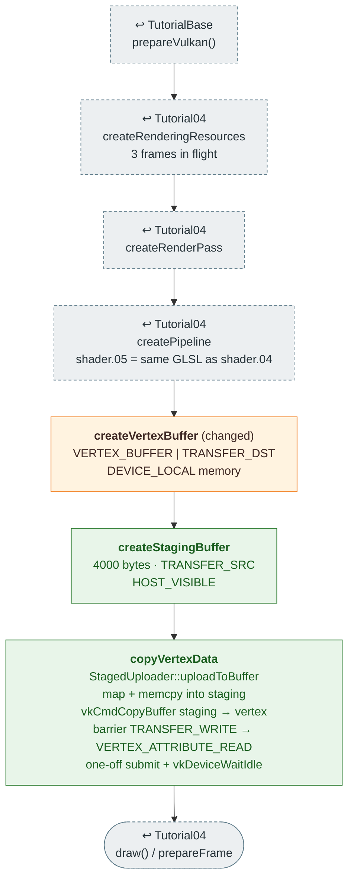

# Tutorial05 — Staging resources

[Index](../vulkan_pipeline_breakdown.md) · Builds on:
[Tutorial04](04_vertex_attributes.md) · Next:
[Tutorial06](06_descriptor_sets.md)

Same quad and same shaders as Tutorial04, but the vertex buffer lives in
device-local memory and is filled through a staging buffer.

**Linked steps:** [TutorialBase](tutorialbase.md);
rendering resources, render pass, pipeline, and the draw loop are
[Tutorial04](04_vertex_attributes.md)'s.

## What's new

- Device-local vertex memory, which the CPU can't write directly.
- A staging buffer and a one-time transfer submit, borrowing the first
  frame's command buffer. This is the `StagedUploader` path every later
  device-local buffer and texture uses.

## Spec links

[`vkCmdCopyBuffer`](https://registry.khronos.org/vulkan/specs/latest/man/html/vkCmdCopyBuffer.html) ·
[`VkBufferMemoryBarrier`](https://registry.khronos.org/vulkan/specs/latest/man/html/VkBufferMemoryBarrier.html) ·
[`VkMemoryPropertyFlagBits`](https://registry.khronos.org/vulkan/specs/latest/man/html/VkMemoryPropertyFlagBits.html)

Source: `bin/05_staging_resources/Tutorial05.cpp`
