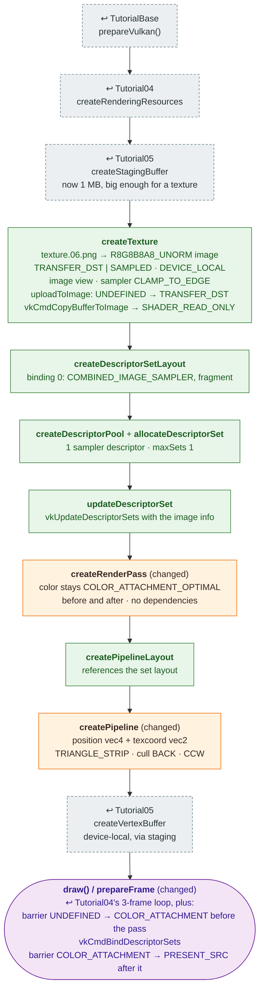

# Tutorial06 — Descriptor sets

[Index](../vulkan_pipeline_breakdown.md) · Builds on:
[Tutorial05](05_staging_resources.md) · Next:
[Tutorial07](07_uniform_buffers.md)

Textures the quad. Adds an image, view, and sampler uploaded through the
staging buffer, and the descriptor set that hands them to the fragment
shader. The render pass stops doing the swapchain layout transitions, so
each frame records them as explicit barriers instead.

**Where the reused boxes come from:**

| Box | Defined in |
|---|---|
| prepareVulkan() | [TutorialBase](tutorialbase.md) |
| createRenderingResources | [Tutorial04](04_vertex_attributes.md) |
| createStagingBuffer | [Tutorial05](05_staging_resources.md) |
| createVertexBuffer | [Tutorial05](05_staging_resources.md) |

## What's new

- Images: device-local optimal-tiling image, view, sampler, and a staged
  upload with two layout transitions (`StagedUploader::uploadToImage`).
- Descriptor set layout, pool, set, and write. The pipeline layout is no
  longer empty.
- The swapchain image's layout changes move out of the render pass into
  per-frame barriers. `FrameLoop` keeps this design for Tutorial11–22.

## Spec links

[`vkCreateImage`](https://registry.khronos.org/vulkan/specs/latest/man/html/vkCreateImage.html) ·
[`vkCreateSampler`](https://registry.khronos.org/vulkan/specs/latest/man/html/vkCreateSampler.html) ·
[`vkCmdCopyBufferToImage`](https://registry.khronos.org/vulkan/specs/latest/man/html/vkCmdCopyBufferToImage.html) ·
[`VkImageMemoryBarrier`](https://registry.khronos.org/vulkan/specs/latest/man/html/VkImageMemoryBarrier.html) ·
[`vkCreateDescriptorSetLayout`](https://registry.khronos.org/vulkan/specs/latest/man/html/vkCreateDescriptorSetLayout.html) ·
[`vkCreateDescriptorPool`](https://registry.khronos.org/vulkan/specs/latest/man/html/vkCreateDescriptorPool.html) ·
[`vkAllocateDescriptorSets`](https://registry.khronos.org/vulkan/specs/latest/man/html/vkAllocateDescriptorSets.html) ·
[`vkUpdateDescriptorSets`](https://registry.khronos.org/vulkan/specs/latest/man/html/vkUpdateDescriptorSets.html) ·
[`vkCmdBindDescriptorSets`](https://registry.khronos.org/vulkan/specs/latest/man/html/vkCmdBindDescriptorSets.html)

Source: `bin/06_descriptor_sets/Tutorial06.cpp`
