# Tutorial07 — Uniform buffers

[Index](../vulkan_pipeline_breakdown.md) · Builds on:
[Tutorial06](06_descriptor_sets.md) · Next:
[Tutorial08](08_phong_sphere.md)

The textured quad gets a projection matrix. Vertex positions are now in
pixels, and a uniform buffer holding an orthographic projection maps them
to clip space.

```mermaid
%%{init: {"flowchart": {"wrappingWidth": 400}}}%%
flowchart TD
    classDef reused fill:#eceff1,stroke:#607d8b,stroke-dasharray:4 3,color:#263238
    classDef changed fill:#fff3e0,stroke:#ef6c00,color:#3e2723
    classDef new fill:#e8f5e9,stroke:#2e7d32,color:#1b5e20
    classDef frame fill:#f3e5f5,stroke:#6a1b9a,color:#311b92

    BASE["↩ TutorialBase<br/>prepareVulkan()"]:::reused
    RR["↩ Tutorial04<br/>createRenderingResources"]:::reused
    STG["↩ Tutorial06<br/>createStagingBuffer (1 MB)"]:::reused
    TEX["↩ Tutorial06<br/>createTexture<br/>texture.07.png"]:::reused
    UBO["<b>createUniformBuffer</b><br/>16 floats (mat4) · UNIFORM | TRANSFER_DST<br/>DEVICE_LOCAL · getOrthographicProjectionMatrix<br/>uploadToBuffer, barrier → UNIFORM_READ<br/>at VERTEX_SHADER stage"]:::new
    DSL["<b>createDescriptorSetLayout</b> (changed)<br/>binding 0: sampler, fragment<br/>binding 1: UNIFORM_BUFFER, vertex"]:::changed
    POOL["<b>createDescriptorPool</b> (changed)<br/>+ allocateDescriptorSet<br/>1 sampler + 1 uniform descriptor"]:::changed
    UPD["<b>updateDescriptorSet</b> (changed)<br/>2 writes: image + buffer"]:::changed
    RP["↩ Tutorial06<br/>createRenderPass"]:::reused
    PLL["↩ Tutorial06<br/>createPipelineLayout"]:::reused
    PIPE["<b>createPipeline</b> (changed)<br/>new vertex shader (multiplies by the matrix)<br/>fragment shader = Tutorial06's"]:::changed
    VB["↩ Tutorial05<br/>createVertexBuffer<br/>pixel-space positions"]:::reused
    DRAW(["↩ Tutorial06<br/>draw() / prepareFrame"]):::reused
    RESIZE["<b>childOnWindowSizeChanged</b><br/>rebuilds everything above,<br/>which recomputes the projection<br/>for the new extent"]:::new

    BASE --> RR --> STG --> TEX --> UBO --> DSL --> POOL --> UPD --> RP --> PLL --> PIPE --> VB --> DRAW
    DRAW -. resize .-> RESIZE

    click BASE "./tutorialbase.md" "TutorialBase"
    click RR "./04_vertex_attributes.md" "Tutorial04"
    click STG "./06_descriptor_sets.md" "Tutorial06"
    click TEX "./06_descriptor_sets.md" "Tutorial06"
    click RP "./06_descriptor_sets.md" "Tutorial06"
    click PLL "./06_descriptor_sets.md" "Tutorial06"
    click VB "./05_staging_resources.md" "Tutorial05"
    click DRAW "./06_descriptor_sets.md" "Tutorial06"
```

**Linked steps:** [TutorialBase](tutorialbase.md);
[Tutorial04](04_vertex_attributes.md) (rendering resources);
[Tutorial05](05_staging_resources.md) (vertex buffer);
[Tutorial06](06_descriptor_sets.md) (staging size, texture, render pass,
pipeline layout, frame recording).

## What's new

- A uniform buffer, uploaded once through staging into device-local
  memory. Tutorial08 switches to a host-visible one rewritten every frame.
- Two descriptor types in one set.
- First projection matrix (orthographic).

## Spec links

[`VkDescriptorBufferInfo`](https://registry.khronos.org/vulkan/specs/latest/man/html/VkDescriptorBufferInfo.html) ·
[`VkWriteDescriptorSet`](https://registry.khronos.org/vulkan/specs/latest/man/html/VkWriteDescriptorSet.html) ·
[`VkDescriptorType`](https://registry.khronos.org/vulkan/specs/latest/man/html/VkDescriptorType.html)

Source: `bin/07_uniform_buffers/Tutorial07.cpp`
