# Tutorial07 — Uniform buffers

[Index](../vulkan_pipeline_breakdown.md) · Builds on:
[Tutorial06](06_descriptor_sets.md) · Next:
[Tutorial08](08_phong_sphere.md)

The textured quad gets a projection matrix. Vertex positions are now in
pixels, and a uniform buffer holding an orthographic projection maps them
to clip space.

```mermaid
%%{init: {"flowchart": {"wrappingWidth": 400}}}%%
flowchart TD
    classDef reused fill:#eceff1,stroke:#607d8b,stroke-dasharray:4 3,color:#263238
    classDef changed fill:#fff3e0,stroke:#ef6c00,color:#3e2723
    classDef new fill:#e8f5e9,stroke:#2e7d32,color:#1b5e20
    classDef frame fill:#f3e5f5,stroke:#6a1b9a,color:#311b92

    BASE["↩ TutorialBase<br/><b>prepareVulkan()</b>"]:::reused
    RR["↩ Tutorial04<br/><b>createRenderingResources</b><br/>vkCreateCommandPool  ·  vkAllocateCommandBuffers<br/>vkCreateSemaphore  ·  vkCreateFence"]:::reused
    STG["↩ Tutorial06<br/><b>createStagingBuffer</b><br/>vkCreateBuffer  ·  vkAllocateMemory<br/>vkBindBufferMemory"]:::reused
    TEX["↩ Tutorial06<br/><b>createTexture</b><br/>vkCreateImage  ·  vkAllocateMemory<br/>vkBindImageMemory  ·  vkCreateImageView<br/>vkCreateSampler  ·  vkCmdPipelineBarrier<br/>vkCmdCopyBufferToImage  ·  vkQueueSubmit"]:::reused
    UBO["<b>createUniformBuffer</b><br/>vkCreateBuffer  ·  vkAllocateMemory<br/>vkBindBufferMemory  ·  vkCmdCopyBuffer<br/>vkCmdPipelineBarrier  ·  vkQueueSubmit"]:::new
    DSL["<b>createDescriptorSetLayout</b><br/>vkCreateDescriptorSetLayout"]:::changed
    POOL["<b>createDescriptorPool</b><br/><b>allocateDescriptorSet</b><br/>vkCreateDescriptorPool  ·  vkAllocateDescriptorSets"]:::changed
    UPD["<b>updateDescriptorSet</b><br/>vkUpdateDescriptorSets"]:::changed
    RP["↩ Tutorial06<br/><b>createRenderPass</b><br/>vkCreateRenderPass"]:::reused
    PLL["↩ Tutorial06<br/><b>createPipelineLayout</b><br/>vkCreatePipelineLayout"]:::reused
    PIPE["<b>createPipeline</b><br/>vkCreateShaderModule  ·  vkCreateGraphicsPipelines"]:::changed
    VB["↩ Tutorial05<br/><b>createVertexBuffer</b><br/>vkCreateBuffer  ·  vkAllocateMemory<br/>vkBindBufferMemory  ·  vkCmdCopyBuffer<br/>vkCmdPipelineBarrier  ·  vkQueueSubmit"]:::reused
    DRAW(["↩ Tutorial06<br/><b>draw() / prepareFrame</b><br/>vkWaitForFences  ·  vkResetFences<br/>vkAcquireNextImageKHR  ·  vkCreateFramebuffer<br/>vkBeginCommandBuffer  ·  vkCmdPipelineBarrier<br/>vkCmdBeginRenderPass  ·  vkCmdBindPipeline<br/>vkCmdSetViewport  ·  vkCmdSetScissor<br/>vkCmdBindVertexBuffers  ·  vkCmdBindDescriptorSets<br/>vkCmdDraw  ·  vkCmdEndRenderPass<br/>vkEndCommandBuffer  ·  vkQueueSubmit<br/>vkQueuePresentKHR"]):::reused
    RESIZE["<b>childOnWindowSizeChanged</b><br/>vkDeviceWaitIdle"]:::new

    BASE --> RR --> STG --> TEX --> UBO --> DSL --> POOL --> UPD --> RP --> PLL --> PIPE --> VB --> DRAW
    DRAW -. resize .-> RESIZE
```

| Step | From | Vulkan calls |
|---|---|---|
| **prepareVulkan()** | [TutorialBase](tutorialbase.md) | — |
| **createRenderingResources** | [Tutorial04](04_vertex_attributes.md) | [vkCreateCommandPool](https://registry.khronos.org/vulkan/specs/latest/man/html/vkCreateCommandPool.html), [vkAllocateCommandBuffers](https://registry.khronos.org/vulkan/specs/latest/man/html/vkAllocateCommandBuffers.html), [vkCreateSemaphore](https://registry.khronos.org/vulkan/specs/latest/man/html/vkCreateSemaphore.html), [vkCreateFence](https://registry.khronos.org/vulkan/specs/latest/man/html/vkCreateFence.html) |
| **createStagingBuffer** | [Tutorial06](06_descriptor_sets.md) | [vkCreateBuffer](https://registry.khronos.org/vulkan/specs/latest/man/html/vkCreateBuffer.html), [vkAllocateMemory](https://registry.khronos.org/vulkan/specs/latest/man/html/vkAllocateMemory.html), [vkBindBufferMemory](https://registry.khronos.org/vulkan/specs/latest/man/html/vkBindBufferMemory.html) |
| **createTexture** | [Tutorial06](06_descriptor_sets.md) | [vkCreateImage](https://registry.khronos.org/vulkan/specs/latest/man/html/vkCreateImage.html), [vkAllocateMemory](https://registry.khronos.org/vulkan/specs/latest/man/html/vkAllocateMemory.html), [vkBindImageMemory](https://registry.khronos.org/vulkan/specs/latest/man/html/vkBindImageMemory.html), [vkCreateImageView](https://registry.khronos.org/vulkan/specs/latest/man/html/vkCreateImageView.html), [vkCreateSampler](https://registry.khronos.org/vulkan/specs/latest/man/html/vkCreateSampler.html), [vkCmdPipelineBarrier](https://registry.khronos.org/vulkan/specs/latest/man/html/vkCmdPipelineBarrier.html), [vkCmdCopyBufferToImage](https://registry.khronos.org/vulkan/specs/latest/man/html/vkCmdCopyBufferToImage.html), [vkQueueSubmit](https://registry.khronos.org/vulkan/specs/latest/man/html/vkQueueSubmit.html) |
| **createUniformBuffer** | new here | [vkCreateBuffer](https://registry.khronos.org/vulkan/specs/latest/man/html/vkCreateBuffer.html), [vkAllocateMemory](https://registry.khronos.org/vulkan/specs/latest/man/html/vkAllocateMemory.html), [vkBindBufferMemory](https://registry.khronos.org/vulkan/specs/latest/man/html/vkBindBufferMemory.html), [vkCmdCopyBuffer](https://registry.khronos.org/vulkan/specs/latest/man/html/vkCmdCopyBuffer.html), [vkCmdPipelineBarrier](https://registry.khronos.org/vulkan/specs/latest/man/html/vkCmdPipelineBarrier.html), [vkQueueSubmit](https://registry.khronos.org/vulkan/specs/latest/man/html/vkQueueSubmit.html) |
| **createDescriptorSetLayout** | changed here | [vkCreateDescriptorSetLayout](https://registry.khronos.org/vulkan/specs/latest/man/html/vkCreateDescriptorSetLayout.html) |
| **createDescriptorPool · allocateDescriptorSet** | changed here | [vkCreateDescriptorPool](https://registry.khronos.org/vulkan/specs/latest/man/html/vkCreateDescriptorPool.html), [vkAllocateDescriptorSets](https://registry.khronos.org/vulkan/specs/latest/man/html/vkAllocateDescriptorSets.html) |
| **updateDescriptorSet** | changed here | [vkUpdateDescriptorSets](https://registry.khronos.org/vulkan/specs/latest/man/html/vkUpdateDescriptorSets.html) |
| **createRenderPass** | [Tutorial06](06_descriptor_sets.md) | [vkCreateRenderPass](https://registry.khronos.org/vulkan/specs/latest/man/html/vkCreateRenderPass.html) |
| **createPipelineLayout** | [Tutorial06](06_descriptor_sets.md) | [vkCreatePipelineLayout](https://registry.khronos.org/vulkan/specs/latest/man/html/vkCreatePipelineLayout.html) |
| **createPipeline** | changed here | [vkCreateShaderModule](https://registry.khronos.org/vulkan/specs/latest/man/html/vkCreateShaderModule.html), [vkCreateGraphicsPipelines](https://registry.khronos.org/vulkan/specs/latest/man/html/vkCreateGraphicsPipelines.html) |
| **createVertexBuffer** | [Tutorial05](05_staging_resources.md) | [vkCreateBuffer](https://registry.khronos.org/vulkan/specs/latest/man/html/vkCreateBuffer.html), [vkAllocateMemory](https://registry.khronos.org/vulkan/specs/latest/man/html/vkAllocateMemory.html), [vkBindBufferMemory](https://registry.khronos.org/vulkan/specs/latest/man/html/vkBindBufferMemory.html), [vkCmdCopyBuffer](https://registry.khronos.org/vulkan/specs/latest/man/html/vkCmdCopyBuffer.html), [vkCmdPipelineBarrier](https://registry.khronos.org/vulkan/specs/latest/man/html/vkCmdPipelineBarrier.html), [vkQueueSubmit](https://registry.khronos.org/vulkan/specs/latest/man/html/vkQueueSubmit.html) |
| **draw() / prepareFrame** | [Tutorial06](06_descriptor_sets.md) | [vkWaitForFences](https://registry.khronos.org/vulkan/specs/latest/man/html/vkWaitForFences.html), [vkResetFences](https://registry.khronos.org/vulkan/specs/latest/man/html/vkResetFences.html), [vkAcquireNextImageKHR](https://registry.khronos.org/vulkan/specs/latest/man/html/vkAcquireNextImageKHR.html), [vkCreateFramebuffer](https://registry.khronos.org/vulkan/specs/latest/man/html/vkCreateFramebuffer.html), [vkBeginCommandBuffer](https://registry.khronos.org/vulkan/specs/latest/man/html/vkBeginCommandBuffer.html), [vkCmdPipelineBarrier](https://registry.khronos.org/vulkan/specs/latest/man/html/vkCmdPipelineBarrier.html), [vkCmdBeginRenderPass](https://registry.khronos.org/vulkan/specs/latest/man/html/vkCmdBeginRenderPass.html), [vkCmdBindPipeline](https://registry.khronos.org/vulkan/specs/latest/man/html/vkCmdBindPipeline.html), [vkCmdSetViewport](https://registry.khronos.org/vulkan/specs/latest/man/html/vkCmdSetViewport.html), [vkCmdSetScissor](https://registry.khronos.org/vulkan/specs/latest/man/html/vkCmdSetScissor.html), [vkCmdBindVertexBuffers](https://registry.khronos.org/vulkan/specs/latest/man/html/vkCmdBindVertexBuffers.html), [vkCmdBindDescriptorSets](https://registry.khronos.org/vulkan/specs/latest/man/html/vkCmdBindDescriptorSets.html), [vkCmdDraw](https://registry.khronos.org/vulkan/specs/latest/man/html/vkCmdDraw.html), [vkCmdEndRenderPass](https://registry.khronos.org/vulkan/specs/latest/man/html/vkCmdEndRenderPass.html), [vkEndCommandBuffer](https://registry.khronos.org/vulkan/specs/latest/man/html/vkEndCommandBuffer.html), [vkQueueSubmit](https://registry.khronos.org/vulkan/specs/latest/man/html/vkQueueSubmit.html), [vkQueuePresentKHR](https://registry.khronos.org/vulkan/specs/latest/man/html/vkQueuePresentKHR.html) |
| **childOnWindowSizeChanged** | new here | [vkDeviceWaitIdle](https://registry.khronos.org/vulkan/specs/latest/man/html/vkDeviceWaitIdle.html) |

## What's new

- A uniform buffer, uploaded once through staging into device-local
  memory. Tutorial08 switches to a host-visible one rewritten every frame.
- Two descriptor types in one set.
- First projection matrix (orthographic).

Source: `bin/07_uniform_buffers/Tutorial07.cpp`
