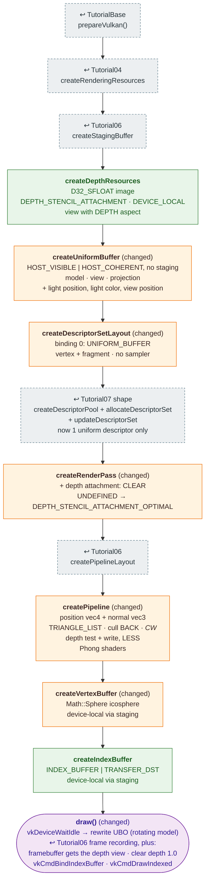

# Tutorial08 — Phong sphere

[Index](../vulkan_pipeline_breakdown.md) · Builds on:
[Tutorial07](07_uniform_buffers.md) · Next:
[Tutorial09](09_tessellated_terrain.md)

A lit, rotating icosphere. Goes 3D: depth buffer, index buffer,
perspective projection, and a uniform buffer rewritten every frame. There
is no texture in this one.

**Where the reused boxes come from:**

| Box | Defined in |
|---|---|
| prepareVulkan() | [TutorialBase](tutorialbase.md) |
| createRenderingResources | [Tutorial04](04_vertex_attributes.md) |
| createStagingBuffer | [Tutorial06](06_descriptor_sets.md) |
| createDescriptorPool + allocateDescriptorSet | [Tutorial07](07_uniform_buffers.md) |
| createPipelineLayout | [Tutorial06](06_descriptor_sets.md) |

## What's new

- Depth image and a second render pass attachment.
- Index buffer and indexed draws.
- Perspective projection (`Tools::getPerspectiveProjectionMatrix`).
- One shared host-visible uniform buffer, rewritten each frame after
  `vkDeviceWaitIdle`. Tutorial09–22 all use this approach.
- Front face is clockwise to match the sphere's winding.

## Spec links

[`VkPipelineDepthStencilStateCreateInfo`](https://registry.khronos.org/vulkan/specs/latest/man/html/VkPipelineDepthStencilStateCreateInfo.html) ·
[`vkCmdBindIndexBuffer`](https://registry.khronos.org/vulkan/specs/latest/man/html/vkCmdBindIndexBuffer.html) ·
[`vkCmdDrawIndexed`](https://registry.khronos.org/vulkan/specs/latest/man/html/vkCmdDrawIndexed.html)

Source: `bin/08_phong_sphere/Tutorial08.cpp`
