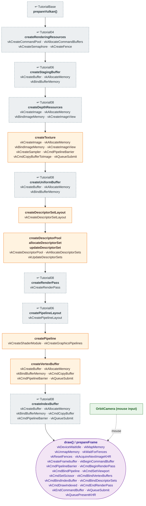

# Tutorial09 — Tessellated terrain

[Index](../vulkan_pipeline_breakdown.md) · Builds on:
[Tutorial08](08_phong_sphere.md), with the texture path from
[Tutorial07](07_uniform_buffers.md) · Next:
[Tutorial10](10_spline_polyline.md)

A lit, textured, tessellated flat terrain viewed through a mouse-driven
orbit camera. Same 3D setup as Tutorial08, with the texture brought back
and backface culling turned off so the underside is visible.

| Step | From | Vulkan calls |
|---|---|---|
| **prepareVulkan()** | [TutorialBase](tutorialbase.md) | — |
| **createRenderingResources** | [Tutorial04](04_vertex_attributes.md) | [vkCreateCommandPool](https://registry.khronos.org/vulkan/specs/latest/man/html/vkCreateCommandPool.html), [vkAllocateCommandBuffers](https://registry.khronos.org/vulkan/specs/latest/man/html/vkAllocateCommandBuffers.html), [vkCreateSemaphore](https://registry.khronos.org/vulkan/specs/latest/man/html/vkCreateSemaphore.html), [vkCreateFence](https://registry.khronos.org/vulkan/specs/latest/man/html/vkCreateFence.html) |
| **createStagingBuffer** | [Tutorial06](06_descriptor_sets.md) | [vkCreateBuffer](https://registry.khronos.org/vulkan/specs/latest/man/html/vkCreateBuffer.html), [vkAllocateMemory](https://registry.khronos.org/vulkan/specs/latest/man/html/vkAllocateMemory.html), [vkBindBufferMemory](https://registry.khronos.org/vulkan/specs/latest/man/html/vkBindBufferMemory.html) |
| **createDepthResources** | [Tutorial08](08_phong_sphere.md) | [vkCreateImage](https://registry.khronos.org/vulkan/specs/latest/man/html/vkCreateImage.html), [vkAllocateMemory](https://registry.khronos.org/vulkan/specs/latest/man/html/vkAllocateMemory.html), [vkBindImageMemory](https://registry.khronos.org/vulkan/specs/latest/man/html/vkBindImageMemory.html), [vkCreateImageView](https://registry.khronos.org/vulkan/specs/latest/man/html/vkCreateImageView.html) |
| **createTexture** | [Tutorial07](07_uniform_buffers.md) | [vkCreateImage](https://registry.khronos.org/vulkan/specs/latest/man/html/vkCreateImage.html), [vkAllocateMemory](https://registry.khronos.org/vulkan/specs/latest/man/html/vkAllocateMemory.html), [vkBindImageMemory](https://registry.khronos.org/vulkan/specs/latest/man/html/vkBindImageMemory.html), [vkCreateImageView](https://registry.khronos.org/vulkan/specs/latest/man/html/vkCreateImageView.html), [vkCreateSampler](https://registry.khronos.org/vulkan/specs/latest/man/html/vkCreateSampler.html), [vkCmdPipelineBarrier](https://registry.khronos.org/vulkan/specs/latest/man/html/vkCmdPipelineBarrier.html), [vkCmdCopyBufferToImage](https://registry.khronos.org/vulkan/specs/latest/man/html/vkCmdCopyBufferToImage.html), [vkQueueSubmit](https://registry.khronos.org/vulkan/specs/latest/man/html/vkQueueSubmit.html) |
| **createUniformBuffer** | [Tutorial08](08_phong_sphere.md) | [vkCreateBuffer](https://registry.khronos.org/vulkan/specs/latest/man/html/vkCreateBuffer.html), [vkAllocateMemory](https://registry.khronos.org/vulkan/specs/latest/man/html/vkAllocateMemory.html), [vkBindBufferMemory](https://registry.khronos.org/vulkan/specs/latest/man/html/vkBindBufferMemory.html) |
| **createDescriptorSetLayout** | changed here | [vkCreateDescriptorSetLayout](https://registry.khronos.org/vulkan/specs/latest/man/html/vkCreateDescriptorSetLayout.html) |
| **createDescriptorPool · allocateDescriptorSet · updateDescriptorSet** | changed here | [vkCreateDescriptorPool](https://registry.khronos.org/vulkan/specs/latest/man/html/vkCreateDescriptorPool.html), [vkAllocateDescriptorSets](https://registry.khronos.org/vulkan/specs/latest/man/html/vkAllocateDescriptorSets.html), [vkUpdateDescriptorSets](https://registry.khronos.org/vulkan/specs/latest/man/html/vkUpdateDescriptorSets.html) |
| **createRenderPass** | [Tutorial08](08_phong_sphere.md) | [vkCreateRenderPass](https://registry.khronos.org/vulkan/specs/latest/man/html/vkCreateRenderPass.html) |
| **createPipelineLayout** | [Tutorial06](06_descriptor_sets.md) | [vkCreatePipelineLayout](https://registry.khronos.org/vulkan/specs/latest/man/html/vkCreatePipelineLayout.html) |
| **createPipeline** | changed here | [vkCreateShaderModule](https://registry.khronos.org/vulkan/specs/latest/man/html/vkCreateShaderModule.html), [vkCreateGraphicsPipelines](https://registry.khronos.org/vulkan/specs/latest/man/html/vkCreateGraphicsPipelines.html) |
| **createVertexBuffer** | changed here | [vkCreateBuffer](https://registry.khronos.org/vulkan/specs/latest/man/html/vkCreateBuffer.html), [vkAllocateMemory](https://registry.khronos.org/vulkan/specs/latest/man/html/vkAllocateMemory.html), [vkBindBufferMemory](https://registry.khronos.org/vulkan/specs/latest/man/html/vkBindBufferMemory.html), [vkCmdCopyBuffer](https://registry.khronos.org/vulkan/specs/latest/man/html/vkCmdCopyBuffer.html), [vkCmdPipelineBarrier](https://registry.khronos.org/vulkan/specs/latest/man/html/vkCmdPipelineBarrier.html), [vkQueueSubmit](https://registry.khronos.org/vulkan/specs/latest/man/html/vkQueueSubmit.html) |
| **createIndexBuffer** | [Tutorial08](08_phong_sphere.md) | [vkCreateBuffer](https://registry.khronos.org/vulkan/specs/latest/man/html/vkCreateBuffer.html), [vkAllocateMemory](https://registry.khronos.org/vulkan/specs/latest/man/html/vkAllocateMemory.html), [vkBindBufferMemory](https://registry.khronos.org/vulkan/specs/latest/man/html/vkBindBufferMemory.html), [vkCmdCopyBuffer](https://registry.khronos.org/vulkan/specs/latest/man/html/vkCmdCopyBuffer.html), [vkCmdPipelineBarrier](https://registry.khronos.org/vulkan/specs/latest/man/html/vkCmdPipelineBarrier.html), [vkQueueSubmit](https://registry.khronos.org/vulkan/specs/latest/man/html/vkQueueSubmit.html) |
| **draw() / prepareFrame** | this tutorial | [vkDeviceWaitIdle](https://registry.khronos.org/vulkan/specs/latest/man/html/vkDeviceWaitIdle.html), [vkMapMemory](https://registry.khronos.org/vulkan/specs/latest/man/html/vkMapMemory.html), [vkUnmapMemory](https://registry.khronos.org/vulkan/specs/latest/man/html/vkUnmapMemory.html), [vkWaitForFences](https://registry.khronos.org/vulkan/specs/latest/man/html/vkWaitForFences.html), [vkResetFences](https://registry.khronos.org/vulkan/specs/latest/man/html/vkResetFences.html), [vkAcquireNextImageKHR](https://registry.khronos.org/vulkan/specs/latest/man/html/vkAcquireNextImageKHR.html), [vkCreateFramebuffer](https://registry.khronos.org/vulkan/specs/latest/man/html/vkCreateFramebuffer.html), [vkBeginCommandBuffer](https://registry.khronos.org/vulkan/specs/latest/man/html/vkBeginCommandBuffer.html), [vkCmdPipelineBarrier](https://registry.khronos.org/vulkan/specs/latest/man/html/vkCmdPipelineBarrier.html), [vkCmdBeginRenderPass](https://registry.khronos.org/vulkan/specs/latest/man/html/vkCmdBeginRenderPass.html), [vkCmdBindPipeline](https://registry.khronos.org/vulkan/specs/latest/man/html/vkCmdBindPipeline.html), [vkCmdSetViewport](https://registry.khronos.org/vulkan/specs/latest/man/html/vkCmdSetViewport.html), [vkCmdSetScissor](https://registry.khronos.org/vulkan/specs/latest/man/html/vkCmdSetScissor.html), [vkCmdBindVertexBuffers](https://registry.khronos.org/vulkan/specs/latest/man/html/vkCmdBindVertexBuffers.html), [vkCmdBindIndexBuffer](https://registry.khronos.org/vulkan/specs/latest/man/html/vkCmdBindIndexBuffer.html), [vkCmdBindDescriptorSets](https://registry.khronos.org/vulkan/specs/latest/man/html/vkCmdBindDescriptorSets.html), [vkCmdDrawIndexed](https://registry.khronos.org/vulkan/specs/latest/man/html/vkCmdDrawIndexed.html), [vkCmdEndRenderPass](https://registry.khronos.org/vulkan/specs/latest/man/html/vkCmdEndRenderPass.html), [vkEndCommandBuffer](https://registry.khronos.org/vulkan/specs/latest/man/html/vkEndCommandBuffer.html), [vkQueueSubmit](https://registry.khronos.org/vulkan/specs/latest/man/html/vkQueueSubmit.html), [vkQueuePresentKHR](https://registry.khronos.org/vulkan/specs/latest/man/html/vkQueuePresentKHR.html) |
| **OrbitCamera (mouse input)** | new here | — |

## What's new

- All three vertex attributes together: position, normal, texcoord.
- `VK_SAMPLER_ADDRESS_MODE_REPEAT` tiling.
- Culling off. Every pipeline before this one culled back faces.
- Mouse input and `OrbitCamera`, later moved to `lib/` and shared by
  every 3D tutorial.

Source: `bin/09_tessellated_terrain/Tutorial09.cpp`
