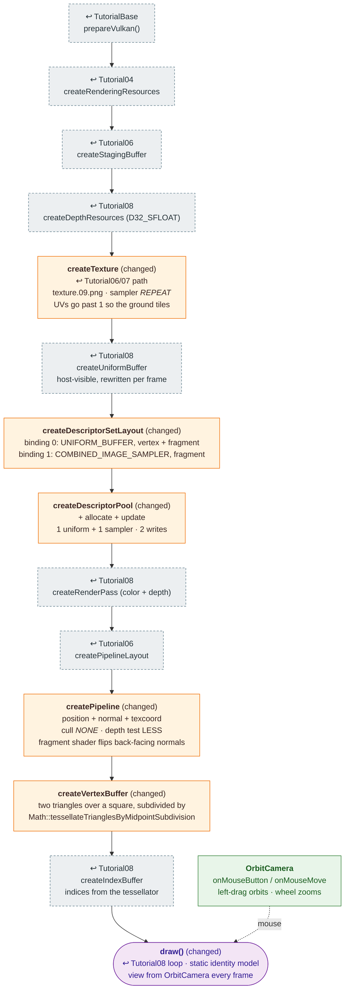

# Tutorial09 — Tessellated terrain

[Index](../vulkan_pipeline_breakdown.md) · Builds on:
[Tutorial08](08_phong_sphere.md), with the texture path from
[Tutorial07](07_uniform_buffers.md) · Next:
[Tutorial10](10_spline_polyline.md)

A lit, textured, tessellated flat terrain viewed through a mouse-driven
orbit camera. Same 3D setup as Tutorial08, with the texture brought back
and backface culling turned off so the underside is visible.

**Where the reused boxes come from:**

| Box | Defined in |
|---|---|
| prepareVulkan() | [TutorialBase](tutorialbase.md) |
| createRenderingResources | [Tutorial04](04_vertex_attributes.md) |
| createStagingBuffer | [Tutorial06](06_descriptor_sets.md) |
| createDepthResources (D32_SFLOAT) | [Tutorial08](08_phong_sphere.md) |
| createTexture | [Tutorial07](07_uniform_buffers.md) |
| createUniformBuffer | [Tutorial08](08_phong_sphere.md) |
| createRenderPass (color + depth) | [Tutorial08](08_phong_sphere.md) |
| createPipelineLayout | [Tutorial06](06_descriptor_sets.md) |
| createIndexBuffer | [Tutorial08](08_phong_sphere.md) |

## What's new

- All three vertex attributes together: position, normal, texcoord.
- `VK_SAMPLER_ADDRESS_MODE_REPEAT` tiling.
- Culling off. Every pipeline before this one culled back faces.
- Mouse input and `OrbitCamera`, later moved to `lib/` and shared by
  every 3D tutorial.

Source: `bin/09_tessellated_terrain/Tutorial09.cpp`
