# Tutorial10 — Spline polyline

[Index](../vulkan_pipeline_breakdown.md) · Builds on:
[Tutorial09](09_tessellated_terrain.md) · Next:
[Tutorial11](11_skybox.md)

A Catmull-Rom spline sampled by `Math::CubicCurve` and drawn as a thick
line strip, with its control polygon drawn thinner from the same pipeline.
The first tutorial with line topology, push constants, and a dynamic line
width.

```mermaid
%%{init: {"flowchart": {"wrappingWidth": 400}}}%%
flowchart TD
    classDef reused fill:#eceff1,stroke:#607d8b,stroke-dasharray:4 3,color:#263238
    classDef changed fill:#fff3e0,stroke:#ef6c00,color:#3e2723
    classDef new fill:#e8f5e9,stroke:#2e7d32,color:#1b5e20
    classDef frame fill:#f3e5f5,stroke:#6a1b9a,color:#311b92

    BASE["↩ TutorialBase<br/><b>prepareVulkan()</b>"]:::reused
    RR["↩ Tutorial04<br/><b>createRenderingResources</b><br/>vkCreateCommandPool  ·  vkAllocateCommandBuffers<br/>vkCreateSemaphore  ·  vkCreateFence"]:::reused
    STG["↩ Tutorial06<br/><b>createStagingBuffer</b><br/>vkCreateBuffer  ·  vkAllocateMemory<br/>vkBindBufferMemory"]:::reused
    DEPTH["↩ Tutorial08<br/><b>createDepthResources</b><br/>vkCreateImage  ·  vkAllocateMemory<br/>vkBindImageMemory  ·  vkCreateImageView"]:::reused
    UBO["<b>createUniformBuffer</b><br/>vkCreateBuffer  ·  vkAllocateMemory<br/>vkBindBufferMemory"]:::changed
    DSL["<b>createDescriptorSetLayout</b><br/>vkCreateDescriptorSetLayout"]:::changed
    POOL["↩ Tutorial08<br/><b>createDescriptorPool</b><br/><b>allocateDescriptorSet</b><br/><b>updateDescriptorSet</b><br/>vkCreateDescriptorPool  ·  vkAllocateDescriptorSets<br/>vkUpdateDescriptorSets"]:::reused
    RP["↩ Tutorial08<br/><b>createRenderPass</b><br/>vkCreateRenderPass"]:::reused
    PLL["<b>createPipelineLayout</b><br/>vkCreatePipelineLayout"]:::changed
    PIPE["<b>createLinePipeline</b><br/>vkGetPhysicalDeviceFeatures  ·  vkGetPhysicalDeviceProperties<br/>vkCreateShaderModule  ·  vkCreateGraphicsPipelines"]:::new
    CVB["<b>createCurveVertexBuffer</b><br/>vkCreateBuffer  ·  vkAllocateMemory<br/>vkBindBufferMemory  ·  vkCmdCopyBuffer<br/>vkCmdPipelineBarrier  ·  vkQueueSubmit"]:::new
    PVB["<b>createControlPolygonVertexBuffer</b><br/>vkCreateBuffer  ·  vkAllocateMemory<br/>vkBindBufferMemory  ·  vkCmdCopyBuffer<br/>vkCmdPipelineBarrier  ·  vkQueueSubmit"]:::new
    DRAW(["<b>draw() / prepareFrame</b><br/>vkDeviceWaitIdle  ·  vkMapMemory<br/>vkUnmapMemory  ·  vkWaitForFences<br/>vkResetFences  ·  vkAcquireNextImageKHR<br/>vkCreateFramebuffer  ·  vkBeginCommandBuffer<br/>vkCmdPipelineBarrier  ·  vkCmdBeginRenderPass<br/>vkCmdBindPipeline  ·  vkCmdSetViewport<br/>vkCmdSetScissor  ·  vkCmdBindDescriptorSets<br/>vkCmdBindVertexBuffers  ·  vkCmdPushConstants<br/>vkCmdSetLineWidth  ·  vkCmdDraw<br/>vkCmdEndRenderPass  ·  vkEndCommandBuffer<br/>vkQueueSubmit  ·  vkQueuePresentKHR"]):::frame

    BASE --> RR --> STG --> DEPTH --> UBO --> DSL --> POOL --> RP --> PLL --> PIPE --> CVB --> PVB --> DRAW
```

| Step | From | Vulkan calls |
|---|---|---|
| **prepareVulkan()** | [TutorialBase](tutorialbase.md) | — |
| **createRenderingResources** | [Tutorial04](04_vertex_attributes.md) | [vkCreateCommandPool](https://registry.khronos.org/vulkan/specs/latest/man/html/vkCreateCommandPool.html), [vkAllocateCommandBuffers](https://registry.khronos.org/vulkan/specs/latest/man/html/vkAllocateCommandBuffers.html), [vkCreateSemaphore](https://registry.khronos.org/vulkan/specs/latest/man/html/vkCreateSemaphore.html), [vkCreateFence](https://registry.khronos.org/vulkan/specs/latest/man/html/vkCreateFence.html) |
| **createStagingBuffer** | [Tutorial06](06_descriptor_sets.md) | [vkCreateBuffer](https://registry.khronos.org/vulkan/specs/latest/man/html/vkCreateBuffer.html), [vkAllocateMemory](https://registry.khronos.org/vulkan/specs/latest/man/html/vkAllocateMemory.html), [vkBindBufferMemory](https://registry.khronos.org/vulkan/specs/latest/man/html/vkBindBufferMemory.html) |
| **createDepthResources** | [Tutorial08](08_phong_sphere.md) | [vkCreateImage](https://registry.khronos.org/vulkan/specs/latest/man/html/vkCreateImage.html), [vkAllocateMemory](https://registry.khronos.org/vulkan/specs/latest/man/html/vkAllocateMemory.html), [vkBindImageMemory](https://registry.khronos.org/vulkan/specs/latest/man/html/vkBindImageMemory.html), [vkCreateImageView](https://registry.khronos.org/vulkan/specs/latest/man/html/vkCreateImageView.html) |
| **createUniformBuffer** | changed here | [vkCreateBuffer](https://registry.khronos.org/vulkan/specs/latest/man/html/vkCreateBuffer.html), [vkAllocateMemory](https://registry.khronos.org/vulkan/specs/latest/man/html/vkAllocateMemory.html), [vkBindBufferMemory](https://registry.khronos.org/vulkan/specs/latest/man/html/vkBindBufferMemory.html) |
| **createDescriptorSetLayout** | changed here | [vkCreateDescriptorSetLayout](https://registry.khronos.org/vulkan/specs/latest/man/html/vkCreateDescriptorSetLayout.html) |
| **createDescriptorPool · allocateDescriptorSet · updateDescriptorSet** | [Tutorial08](08_phong_sphere.md) | [vkCreateDescriptorPool](https://registry.khronos.org/vulkan/specs/latest/man/html/vkCreateDescriptorPool.html), [vkAllocateDescriptorSets](https://registry.khronos.org/vulkan/specs/latest/man/html/vkAllocateDescriptorSets.html), [vkUpdateDescriptorSets](https://registry.khronos.org/vulkan/specs/latest/man/html/vkUpdateDescriptorSets.html) |
| **createRenderPass** | [Tutorial08](08_phong_sphere.md) | [vkCreateRenderPass](https://registry.khronos.org/vulkan/specs/latest/man/html/vkCreateRenderPass.html) |
| **createPipelineLayout** | changed here | [vkCreatePipelineLayout](https://registry.khronos.org/vulkan/specs/latest/man/html/vkCreatePipelineLayout.html) |
| **createLinePipeline** | new here | [vkGetPhysicalDeviceFeatures](https://registry.khronos.org/vulkan/specs/latest/man/html/vkGetPhysicalDeviceFeatures.html), [vkGetPhysicalDeviceProperties](https://registry.khronos.org/vulkan/specs/latest/man/html/vkGetPhysicalDeviceProperties.html), [vkCreateShaderModule](https://registry.khronos.org/vulkan/specs/latest/man/html/vkCreateShaderModule.html), [vkCreateGraphicsPipelines](https://registry.khronos.org/vulkan/specs/latest/man/html/vkCreateGraphicsPipelines.html) |
| **createCurveVertexBuffer** | new here | [vkCreateBuffer](https://registry.khronos.org/vulkan/specs/latest/man/html/vkCreateBuffer.html), [vkAllocateMemory](https://registry.khronos.org/vulkan/specs/latest/man/html/vkAllocateMemory.html), [vkBindBufferMemory](https://registry.khronos.org/vulkan/specs/latest/man/html/vkBindBufferMemory.html), [vkCmdCopyBuffer](https://registry.khronos.org/vulkan/specs/latest/man/html/vkCmdCopyBuffer.html), [vkCmdPipelineBarrier](https://registry.khronos.org/vulkan/specs/latest/man/html/vkCmdPipelineBarrier.html), [vkQueueSubmit](https://registry.khronos.org/vulkan/specs/latest/man/html/vkQueueSubmit.html) |
| **createControlPolygonVertexBuffer** | new here | [vkCreateBuffer](https://registry.khronos.org/vulkan/specs/latest/man/html/vkCreateBuffer.html), [vkAllocateMemory](https://registry.khronos.org/vulkan/specs/latest/man/html/vkAllocateMemory.html), [vkBindBufferMemory](https://registry.khronos.org/vulkan/specs/latest/man/html/vkBindBufferMemory.html), [vkCmdCopyBuffer](https://registry.khronos.org/vulkan/specs/latest/man/html/vkCmdCopyBuffer.html), [vkCmdPipelineBarrier](https://registry.khronos.org/vulkan/specs/latest/man/html/vkCmdPipelineBarrier.html), [vkQueueSubmit](https://registry.khronos.org/vulkan/specs/latest/man/html/vkQueueSubmit.html) |
| **draw() / prepareFrame** | this tutorial | [vkDeviceWaitIdle](https://registry.khronos.org/vulkan/specs/latest/man/html/vkDeviceWaitIdle.html), [vkMapMemory](https://registry.khronos.org/vulkan/specs/latest/man/html/vkMapMemory.html), [vkUnmapMemory](https://registry.khronos.org/vulkan/specs/latest/man/html/vkUnmapMemory.html), [vkWaitForFences](https://registry.khronos.org/vulkan/specs/latest/man/html/vkWaitForFences.html), [vkResetFences](https://registry.khronos.org/vulkan/specs/latest/man/html/vkResetFences.html), [vkAcquireNextImageKHR](https://registry.khronos.org/vulkan/specs/latest/man/html/vkAcquireNextImageKHR.html), [vkCreateFramebuffer](https://registry.khronos.org/vulkan/specs/latest/man/html/vkCreateFramebuffer.html), [vkBeginCommandBuffer](https://registry.khronos.org/vulkan/specs/latest/man/html/vkBeginCommandBuffer.html), [vkCmdPipelineBarrier](https://registry.khronos.org/vulkan/specs/latest/man/html/vkCmdPipelineBarrier.html), [vkCmdBeginRenderPass](https://registry.khronos.org/vulkan/specs/latest/man/html/vkCmdBeginRenderPass.html), [vkCmdBindPipeline](https://registry.khronos.org/vulkan/specs/latest/man/html/vkCmdBindPipeline.html), [vkCmdSetViewport](https://registry.khronos.org/vulkan/specs/latest/man/html/vkCmdSetViewport.html), [vkCmdSetScissor](https://registry.khronos.org/vulkan/specs/latest/man/html/vkCmdSetScissor.html), [vkCmdBindDescriptorSets](https://registry.khronos.org/vulkan/specs/latest/man/html/vkCmdBindDescriptorSets.html), [vkCmdBindVertexBuffers](https://registry.khronos.org/vulkan/specs/latest/man/html/vkCmdBindVertexBuffers.html), [vkCmdPushConstants](https://registry.khronos.org/vulkan/specs/latest/man/html/vkCmdPushConstants.html), [vkCmdSetLineWidth](https://registry.khronos.org/vulkan/specs/latest/man/html/vkCmdSetLineWidth.html), [vkCmdDraw](https://registry.khronos.org/vulkan/specs/latest/man/html/vkCmdDraw.html), [vkCmdEndRenderPass](https://registry.khronos.org/vulkan/specs/latest/man/html/vkCmdEndRenderPass.html), [vkEndCommandBuffer](https://registry.khronos.org/vulkan/specs/latest/man/html/vkEndCommandBuffer.html), [vkQueueSubmit](https://registry.khronos.org/vulkan/specs/latest/man/html/vkQueueSubmit.html), [vkQueuePresentKHR](https://registry.khronos.org/vulkan/specs/latest/man/html/vkQueuePresentKHR.html) |

Also builds on: [Tutorial09](09_tessellated_terrain.md).

## What's new

- `VK_PRIMITIVE_TOPOLOGY_LINE_STRIP`.
- Push constants: one range on the layout, pushed twice per frame so one
  pipeline draws two colors.
- `VK_DYNAMIC_STATE_LINE_WIDTH`. `getLineWidth()` clamps the requested
  width to the device's `lineWidthRange`, or uses 1.0 without
  `wideLines`.
- Two draws per frame from two vertex buffers.

Source: `bin/10_spline_polyline/Tutorial10.cpp`
