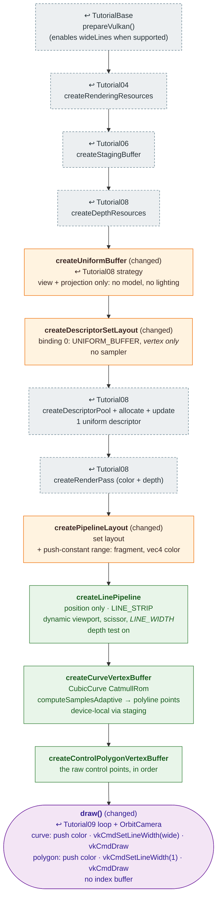

# Tutorial10 — Spline polyline

[Index](../vulkan_pipeline_breakdown.md) · Builds on:
[Tutorial09](09_tessellated_terrain.md) · Next:
[Tutorial11](11_skybox.md)

A Catmull-Rom spline sampled by `Math::CubicCurve` and drawn as a thick
line strip, with its control polygon drawn thinner from the same pipeline.
The first tutorial with line topology, push constants, and a dynamic line
width.

**Linked steps:** [TutorialBase](tutorialbase.md);
[Tutorial04](04_vertex_attributes.md) (rendering resources);
[Tutorial06](06_descriptor_sets.md) (staging);
[Tutorial08](08_phong_sphere.md) (depth, descriptors, render pass);
[Tutorial09](09_tessellated_terrain.md) (frame loop, orbit camera).

## What's new

- `VK_PRIMITIVE_TOPOLOGY_LINE_STRIP`.
- Push constants: one range on the layout, pushed twice per frame so one
  pipeline draws two colors.
- `VK_DYNAMIC_STATE_LINE_WIDTH`. `getLineWidth()` clamps the requested
  width to the device's `lineWidthRange`, or uses 1.0 without
  `wideLines`.
- Two draws per frame from two vertex buffers.

## Spec links

[`VkPushConstantRange`](https://registry.khronos.org/vulkan/specs/latest/man/html/VkPushConstantRange.html) ·
[`vkCmdPushConstants`](https://registry.khronos.org/vulkan/specs/latest/man/html/vkCmdPushConstants.html) ·
[`vkCmdSetLineWidth`](https://registry.khronos.org/vulkan/specs/latest/man/html/vkCmdSetLineWidth.html)

Source: `bin/10_spline_polyline/Tutorial10.cpp`
