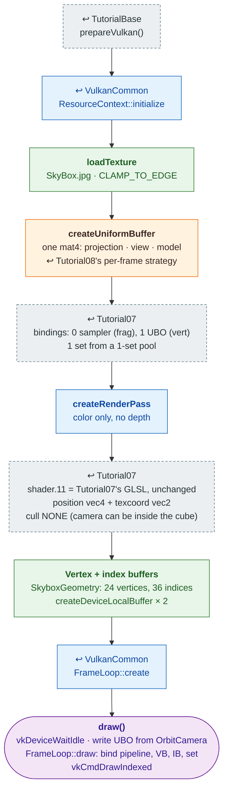

# Tutorial11 — Skybox

[Index](../vulkan_pipeline_breakdown.md) · Builds on:
[Tutorial07](07_uniform_buffers.md)'s shaders, rebuilt on
[VulkanCommon](vulkancommon.md) · Next:
[Tutorial12](12_generated_terrain.md)

An indexed, textured cube using vulkan_earth's skybox faces, viewed with
the orbit camera. This is the first tutorial built on `ResourceContext`
and `FrameLoop`, so everything Tutorial03–10 wrote by hand is a library
call here.

**Linked steps:** [TutorialBase](tutorialbase.md);
[VulkanCommon](vulkancommon.md) (context, render pass, frame loop);
[Tutorial07](07_uniform_buffers.md) (bindings and shaders);
[Tutorial08](08_phong_sphere.md) (per-frame uniform).

## What's new

- The library path: one `createResources()` builds everything, `draw()`
  only records, `childClear()` is `m_frames.destroy();
  m_resources.releaseAll();`.
- `SkyboxGeometry`, shared with vulkan_earth's `SkyboxFactory` and
  [Tutorial21](21_world_scene.md).

Source: `bin/11_skybox/Tutorial11.cpp`
