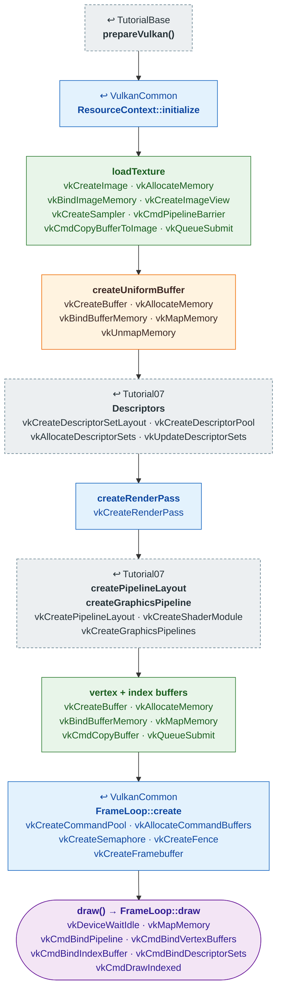

# Tutorial11 — Skybox

[Index](../vulkan_pipeline_breakdown.md) · Builds on:
[Tutorial07](07_uniform_buffers.md)'s shaders, rebuilt on
[VulkanCommon](vulkancommon.md) · Next:
[Tutorial12](12_generated_terrain.md)

An indexed, textured cube using vulkan_earth's skybox faces, viewed with
the orbit camera. This is the first tutorial built on `ResourceContext`
and `FrameLoop`, so everything Tutorial03–10 wrote by hand is a library
call here.

| Step | From | Vulkan calls |
|---|---|---|
| **prepareVulkan()** | [TutorialBase](tutorialbase.md) | — |
| **ResourceContext::initialize** | [VulkanCommon](vulkancommon.md) | — |
| **loadTexture** | new here | [vkCreateImage](https://registry.khronos.org/vulkan/specs/latest/man/html/vkCreateImage.html), [vkAllocateMemory](https://registry.khronos.org/vulkan/specs/latest/man/html/vkAllocateMemory.html), [vkBindImageMemory](https://registry.khronos.org/vulkan/specs/latest/man/html/vkBindImageMemory.html), [vkCreateImageView](https://registry.khronos.org/vulkan/specs/latest/man/html/vkCreateImageView.html), [vkCreateSampler](https://registry.khronos.org/vulkan/specs/latest/man/html/vkCreateSampler.html), [vkCmdPipelineBarrier](https://registry.khronos.org/vulkan/specs/latest/man/html/vkCmdPipelineBarrier.html), [vkCmdCopyBufferToImage](https://registry.khronos.org/vulkan/specs/latest/man/html/vkCmdCopyBufferToImage.html), [vkQueueSubmit](https://registry.khronos.org/vulkan/specs/latest/man/html/vkQueueSubmit.html) |
| **createUniformBuffer** | [Tutorial08](08_phong_sphere.md) | [vkCreateBuffer](https://registry.khronos.org/vulkan/specs/latest/man/html/vkCreateBuffer.html), [vkAllocateMemory](https://registry.khronos.org/vulkan/specs/latest/man/html/vkAllocateMemory.html), [vkBindBufferMemory](https://registry.khronos.org/vulkan/specs/latest/man/html/vkBindBufferMemory.html), [vkMapMemory](https://registry.khronos.org/vulkan/specs/latest/man/html/vkMapMemory.html), [vkUnmapMemory](https://registry.khronos.org/vulkan/specs/latest/man/html/vkUnmapMemory.html) |
| **Descriptors** | [Tutorial07](07_uniform_buffers.md) | [vkCreateDescriptorSetLayout](https://registry.khronos.org/vulkan/specs/latest/man/html/vkCreateDescriptorSetLayout.html), [vkCreateDescriptorPool](https://registry.khronos.org/vulkan/specs/latest/man/html/vkCreateDescriptorPool.html), [vkAllocateDescriptorSets](https://registry.khronos.org/vulkan/specs/latest/man/html/vkAllocateDescriptorSets.html), [vkUpdateDescriptorSets](https://registry.khronos.org/vulkan/specs/latest/man/html/vkUpdateDescriptorSets.html) |
| **createRenderPass** | [VulkanCommon](vulkancommon.md) | [vkCreateRenderPass](https://registry.khronos.org/vulkan/specs/latest/man/html/vkCreateRenderPass.html) |
| **createPipelineLayout · createGraphicsPipeline** | [Tutorial07](07_uniform_buffers.md) | [vkCreatePipelineLayout](https://registry.khronos.org/vulkan/specs/latest/man/html/vkCreatePipelineLayout.html), [vkCreateShaderModule](https://registry.khronos.org/vulkan/specs/latest/man/html/vkCreateShaderModule.html), [vkCreateGraphicsPipelines](https://registry.khronos.org/vulkan/specs/latest/man/html/vkCreateGraphicsPipelines.html) |
| **vertex + index buffers** | new here | [vkCreateBuffer](https://registry.khronos.org/vulkan/specs/latest/man/html/vkCreateBuffer.html), [vkAllocateMemory](https://registry.khronos.org/vulkan/specs/latest/man/html/vkAllocateMemory.html), [vkBindBufferMemory](https://registry.khronos.org/vulkan/specs/latest/man/html/vkBindBufferMemory.html), [vkMapMemory](https://registry.khronos.org/vulkan/specs/latest/man/html/vkMapMemory.html), [vkCmdCopyBuffer](https://registry.khronos.org/vulkan/specs/latest/man/html/vkCmdCopyBuffer.html), [vkQueueSubmit](https://registry.khronos.org/vulkan/specs/latest/man/html/vkQueueSubmit.html) |
| **FrameLoop::create** | [VulkanCommon](vulkancommon.md) | [vkCreateCommandPool](https://registry.khronos.org/vulkan/specs/latest/man/html/vkCreateCommandPool.html), [vkAllocateCommandBuffers](https://registry.khronos.org/vulkan/specs/latest/man/html/vkAllocateCommandBuffers.html), [vkCreateSemaphore](https://registry.khronos.org/vulkan/specs/latest/man/html/vkCreateSemaphore.html), [vkCreateFence](https://registry.khronos.org/vulkan/specs/latest/man/html/vkCreateFence.html), [vkCreateFramebuffer](https://registry.khronos.org/vulkan/specs/latest/man/html/vkCreateFramebuffer.html) |
| **draw() → FrameLoop::draw** | this tutorial | [vkDeviceWaitIdle](https://registry.khronos.org/vulkan/specs/latest/man/html/vkDeviceWaitIdle.html), [vkMapMemory](https://registry.khronos.org/vulkan/specs/latest/man/html/vkMapMemory.html), [vkCmdBindPipeline](https://registry.khronos.org/vulkan/specs/latest/man/html/vkCmdBindPipeline.html), [vkCmdBindVertexBuffers](https://registry.khronos.org/vulkan/specs/latest/man/html/vkCmdBindVertexBuffers.html), [vkCmdBindIndexBuffer](https://registry.khronos.org/vulkan/specs/latest/man/html/vkCmdBindIndexBuffer.html), [vkCmdBindDescriptorSets](https://registry.khronos.org/vulkan/specs/latest/man/html/vkCmdBindDescriptorSets.html), [vkCmdDrawIndexed](https://registry.khronos.org/vulkan/specs/latest/man/html/vkCmdDrawIndexed.html) |

## What's new

- The library path: one `createResources()` builds everything, `draw()`
  only records, `childClear()` is `m_frames.destroy();
  m_resources.releaseAll();`.
- `SkyboxGeometry`, shared with vulkan_earth's `SkyboxFactory` and
  [Tutorial21](21_world_scene.md).

Source: `bin/11_skybox/Tutorial11.cpp`
