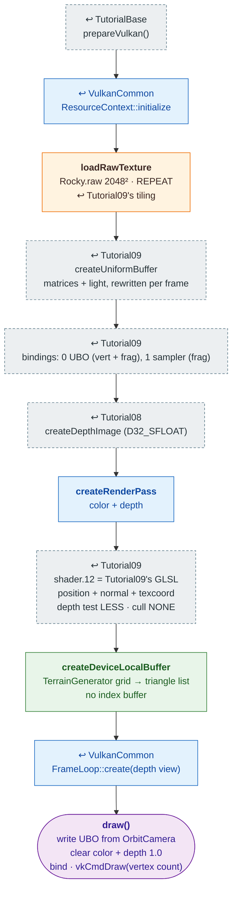

# Tutorial12 — Generated terrain

[Index](../vulkan_pipeline_breakdown.md) · Builds on:
[Tutorial09](09_tessellated_terrain.md)'s shaders, on
[VulkanCommon](vulkancommon.md) · Next:
[Tutorial13](13_projectile_model.md)

A diamond-square height field from `TerrainGenerator` (the same code
vulkan_earth's `TerrainMaker` now calls), lit and textured with Tutorial09's
shaders.

**Where the reused boxes come from:**

| Box | Defined in |
|---|---|
| prepareVulkan() | [TutorialBase](tutorialbase.md) |
| ResourceContext::initialize | [VulkanCommon](vulkancommon.md) |
| createRenderPass | [VulkanCommon](vulkancommon.md) |
| FrameLoop::create(depth view) | [VulkanCommon](vulkancommon.md) |
| loadRawTexture | [Tutorial09](09_tessellated_terrain.md) |
| createUniformBuffer | [Tutorial09](09_tessellated_terrain.md) |
| bindings: 0 UBO (vert + frag), 1 sampler (frag) | [Tutorial09](09_tessellated_terrain.md) |
| shader.12 = Tutorial09's GLSL | [Tutorial09](09_tessellated_terrain.md) |
| createDepthImage (D32_SFLOAT) | [Tutorial08](08_phong_sphere.md) |

## What's new

- First library-built tutorial with a depth attachment, passed to
  `FrameLoop::create()` as the framebuffers' second view.
- `.raw` texture loading (`ResourceContext::loadRawTexture`).
- Geometry from `TerrainGenerator`. [Tutorial21](21_world_scene.md) reuses
  this terrain and pipeline.

Source: `bin/12_generated_terrain/Tutorial12.cpp`
