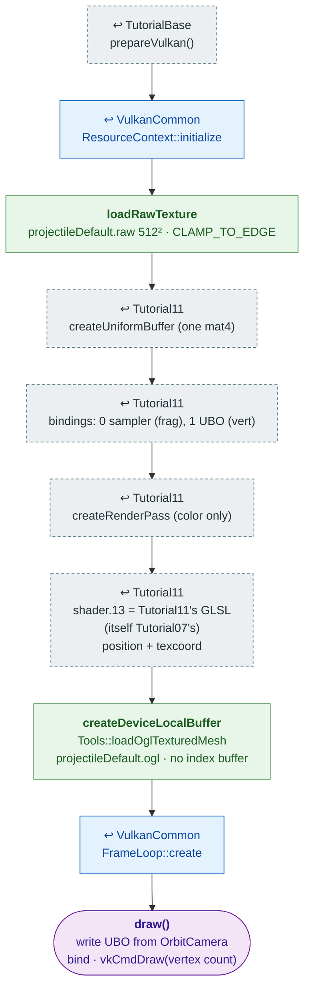

# Tutorial13 — Projectile model

[Index](../vulkan_pipeline_breakdown.md) · Builds on:
[Tutorial11](11_skybox.md) · Next:
[Tutorial14](14_particle_sphere.md)

vulkan_earth's tank-shell mesh, parsed from its `.ogl` file and drawn with
Tutorial11's unlit-textured pipeline.

**Linked steps:** [TutorialBase](tutorialbase.md);
[VulkanCommon](vulkancommon.md); [Tutorial11](11_skybox.md) (uniform,
bindings, render pass, pipeline).

## What's new

- Mesh data from `Tools::loadOglMeshData()`, the single `.ogl` parser
  vulkan_earth uses too. Tutorial16, 18, 19, 21, and 22 load their meshes
  the same way.

Source: `bin/13_projectile_model/Tutorial13.cpp`
