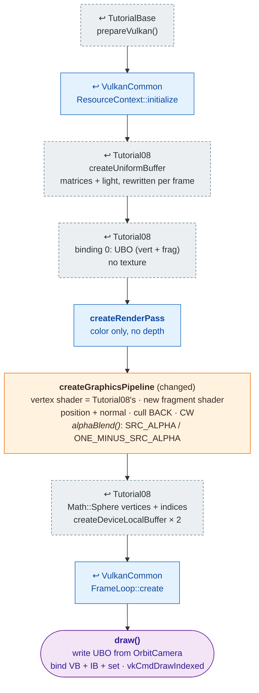

# Tutorial14 — Particle sphere

[Index](../vulkan_pipeline_breakdown.md) · Builds on:
[Tutorial08](08_phong_sphere.md), on [VulkanCommon](vulkancommon.md) ·
Next: [Tutorial15](15_text_and_button.md)

A translucent, alpha-blended sphere, the look of vulkan_earth's particles
and shields. Same `Math::Sphere` and vertex shader as Tutorial08, with a
new fragment shader and blending turned on.

**Where the reused boxes come from:**

| Box | Defined in |
|---|---|
| prepareVulkan() | [TutorialBase](tutorialbase.md) |
| ResourceContext::initialize | [VulkanCommon](vulkancommon.md) |
| createRenderPass | [VulkanCommon](vulkancommon.md) |
| FrameLoop::create | [VulkanCommon](vulkancommon.md) |
| createUniformBuffer | [Tutorial08](08_phong_sphere.md) |
| binding 0: UBO (vert + frag) | [Tutorial08](08_phong_sphere.md) |
| Math::Sphere vertices + indices | [Tutorial08](08_phong_sphere.md) |

## What's new

- Alpha blending (`VulkanCommon::alphaBlend()`), the first pipeline with
  blending enabled. [Tutorial20](20_particle_effects.md) builds on this
  sphere.

Source: `bin/14_particle_sphere/Tutorial14.cpp`
