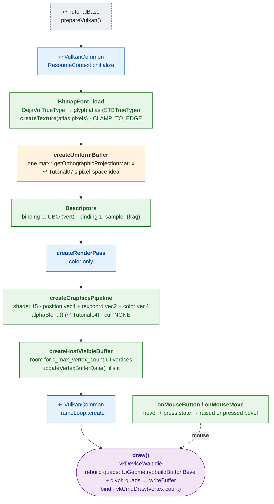

# Tutorial15 — Text and a button

[Index](../vulkan_pipeline_breakdown.md) · Builds on:
[Tutorial07](07_uniform_buffers.md)'s orthographic idea, on
[VulkanCommon](vulkancommon.md) · Next: [Tutorial16](16_tank.md)

A title and one clickable bevel button with a text label: the two pieces
vulkan_earth's whole menu UI is built from. Text comes from a `BitmapFont`
glyph atlas; the vertex buffer is rebuilt from UI state every frame.

**Where the reused boxes come from:**

| Box | Defined in |
|---|---|
| prepareVulkan() | [TutorialBase](tutorialbase.md) |
| ResourceContext::initialize | [VulkanCommon](vulkancommon.md) |
| createRenderPass | [VulkanCommon](vulkancommon.md) |
| FrameLoop::create | [VulkanCommon](vulkancommon.md) |
| createUniformBuffer | [Tutorial07](07_uniform_buffers.md) |

Also builds on: [Tutorial14](14_particle_sphere.md).

## What's new

- A texture built from pixels in memory (the font atlas) rather than a
  file.
- A host-visible vertex buffer rewritten every frame from CPU-side state,
  instead of a device-local one uploaded once.
- Its shaders and pipeline become the 2D UI pipeline for
  [Tutorial17](17_item_inventory.md), [Tutorial18](18_player_tanks_hud.md)'s
  HUD, and [Tutorial22](22_menu_tank_preview.md)'s panel.

Source: `bin/15_text_and_button/Tutorial15.cpp`
