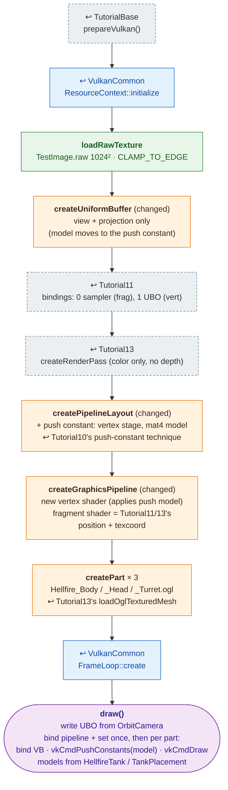

# Tutorial16 — Tank

[Index](../vulkan_pipeline_breakdown.md) · Builds on:
[Tutorial13](13_projectile_model.md) and
[Tutorial10](10_spline_polyline.md)'s push constants · Next:
[Tutorial17](17_item_inventory.md)

vulkan_earth's "Hellfire" tank: three `.ogl` parts (body, head, turret)
sharing one texture, each placed by its own model matrix sent as a push
constant just before its draw.

**Linked steps:** [TutorialBase](tutorialbase.md);
[VulkanCommon](vulkancommon.md); [Tutorial10](10_spline_polyline.md)
(push constants); [Tutorial11](11_skybox.md) (bindings, fragment shader);
[Tutorial13](13_projectile_model.md) (render pass, `.ogl` loading).

## What's new

- Several meshes per frame, each with its own matrix. Tutorial10's push
  constant carried a color; this one carries a matrix.
- Hierarchical part placement: a child part's offset is rotated through
  its parent's basis (`TankPlacement`, `HellfireTank`). Tutorial18, 21,
  and 22 place the tank the same way.
- Its 3D pipeline is reused by [Tutorial19](19_weapons_projectiles.md),
  [Tutorial21](21_world_scene.md), and
  [Tutorial22](22_menu_tank_preview.md).

Source: `bin/16_tank/Tutorial16.cpp`
