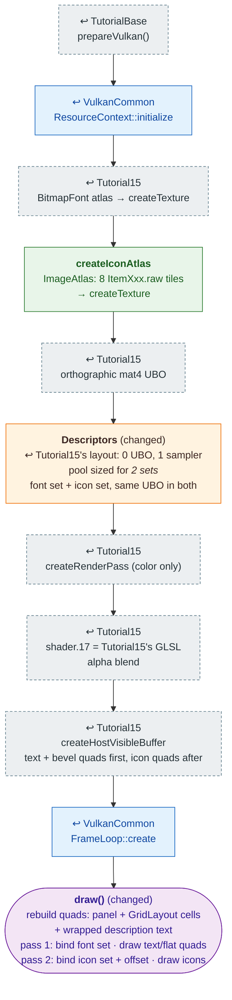

# Tutorial17 — Item inventory

[Index](../vulkan_pipeline_breakdown.md) · Builds on:
[Tutorial15](15_text_and_button.md) · Next:
[Tutorial18](18_player_tanks_hud.md)

A titled bevel panel holding a grid of vulkan_earth's 8 items. Click a
cell to read that item's description. Two textures (the font atlas and an
icon atlas) share one pipeline by using two descriptor sets from the same
layout.

**Where the reused boxes come from:**

| Box | Defined in |
|---|---|
| prepareVulkan() | [TutorialBase](tutorialbase.md) |
| ResourceContext::initialize | [VulkanCommon](vulkancommon.md) |
| FrameLoop::create | [VulkanCommon](vulkancommon.md) |
| BitmapFont atlas → createTexture | [Tutorial15](15_text_and_button.md) |
| orthographic mat4 UBO | [Tutorial15](15_text_and_button.md) |
| createRenderPass (color only) | [Tutorial15](15_text_and_button.md) |
| shader.17 = Tutorial15's GLSL | [Tutorial15](15_text_and_button.md) |
| createHostVisibleBuffer | [Tutorial15](15_text_and_button.md) |

## What's new

- Two descriptor sets allocated from one layout, rebound between draws.
  This is how later tutorials switch textures without a second pipeline.
- Two draws from one vertex buffer at different offsets.
- `ImageAtlas`, `GridLayout`, and `wrapText()` from `lib/`; item data from
  `GameCatalog`.

Source: `bin/17_item_inventory/Tutorial17.cpp`
