# Tutorial18 — Player tanks and HUD

[Index](../vulkan_pipeline_breakdown.md) · Builds on:
[Tutorial16](16_tank.md) (3D) and [Tutorial15](15_text_and_button.md)
(HUD) · Next: [Tutorial19](19_weapons_projectiles.md)

Two Hellfire tanks, each tinted with a team color, plus a HUD overlay with
vulkan_earth's health and power bars. The first tutorial with two
pipelines in one render pass: a depth-tested 3D pass, then a 2D overlay
with depth testing off.

```mermaid
%%{init: {"flowchart": {"wrappingWidth": 400}}}%%
flowchart TD
    classDef reused fill:#eceff1,stroke:#607d8b,stroke-dasharray:4 3,color:#263238
    classDef changed fill:#fff3e0,stroke:#ef6c00,color:#3e2723
    classDef new fill:#e8f5e9,stroke:#2e7d32,color:#1b5e20
    classDef shared fill:#e3f2fd,stroke:#1565c0,color:#0d47a1
    classDef frame fill:#f3e5f5,stroke:#6a1b9a,color:#311b92

    BASE["↩ TutorialBase<br/><b>prepareVulkan()</b>"]:::reused
    RC["↩ VulkanCommon<br/><b>ResourceContext::initialize</b>"]:::shared
    TTEX["↩ Tutorial16<br/><b>loadRawTexture (tank)</b><br/>vkCreateImage  ·  vkAllocateMemory<br/>vkBindImageMemory  ·  vkCreateImageView<br/>vkCreateSampler  ·  vkCmdPipelineBarrier<br/>vkCmdCopyBufferToImage  ·  vkQueueSubmit"]:::reused
    FONT["↩ Tutorial15<br/><b>BitmapFont::load → createTexture</b><br/>vkCreateImage  ·  vkAllocateMemory<br/>vkBindImageMemory  ·  vkCreateImageView<br/>vkCreateSampler  ·  vkCmdPipelineBarrier<br/>vkCmdCopyBufferToImage  ·  vkQueueSubmit"]:::reused
    UBO["<b>createUniformBuffer × 2</b><br/>vkCreateBuffer  ·  vkAllocateMemory<br/>vkBindBufferMemory  ·  vkMapMemory<br/>vkUnmapMemory"]:::changed
    DESC["<b>Descriptors (2 layouts, 2 sets)</b><br/>vkCreateDescriptorSetLayout  ·  vkCreateDescriptorPool<br/>vkAllocateDescriptorSets  ·  vkUpdateDescriptorSets"]:::changed
    DEPTH["↩ Tutorial12<br/><b>createDepthImage · createRenderPass</b><br/>vkCreateImage  ·  vkAllocateMemory<br/>vkBindImageMemory  ·  vkCreateImageView<br/>vkCreateRenderPass"]:::reused
    PLL["<b>createPipelineLayout × 2</b><br/>vkCreatePipelineLayout"]:::changed
    P3D["<b>3D pipeline</b><br/>vkCreateShaderModule  ·  vkCreateGraphicsPipelines"]:::changed
    PHUD["<b>HUD pipeline</b><br/>vkCreateShaderModule  ·  vkCreateGraphicsPipelines"]:::new
    PARTS["↩ Tutorial16<br/><b>createPart × 3</b><br/>vkCreateBuffer  ·  vkAllocateMemory<br/>vkBindBufferMemory  ·  vkMapMemory<br/>vkCmdCopyBuffer  ·  vkQueueSubmit"]:::reused
    HUDVB["<b>HUD vertex buffer</b><br/>vkCreateBuffer  ·  vkAllocateMemory<br/>vkBindBufferMemory  ·  vkMapMemory<br/>vkCmdCopyBuffer  ·  vkQueueSubmit"]:::new
    FL["↩ VulkanCommon<br/><b>FrameLoop::create(depth view)</b><br/>vkCreateCommandPool  ·  vkAllocateCommandBuffers<br/>vkCreateSemaphore  ·  vkCreateFence<br/>vkCreateFramebuffer"]:::shared
    DRAW(["<b>draw() → FrameLoop::draw</b><br/>vkDeviceWaitIdle  ·  vkMapMemory<br/>vkCmdBindPipeline  ·  vkCmdBindDescriptorSets<br/>vkCmdBindVertexBuffers  ·  vkCmdPushConstants<br/>vkCmdDraw"]):::frame

    BASE --> RC --> TTEX --> FONT --> UBO --> DESC --> DEPTH --> PLL --> P3D --> PHUD --> PARTS --> HUDVB --> FL --> DRAW
```

| Step | From | Vulkan calls |
|---|---|---|
| **prepareVulkan()** | [TutorialBase](tutorialbase.md) | — |
| **ResourceContext::initialize** | [VulkanCommon](vulkancommon.md) | — |
| **loadRawTexture (tank)** | [Tutorial16](16_tank.md) | [vkCreateImage](https://registry.khronos.org/vulkan/specs/latest/man/html/vkCreateImage.html), [vkAllocateMemory](https://registry.khronos.org/vulkan/specs/latest/man/html/vkAllocateMemory.html), [vkBindImageMemory](https://registry.khronos.org/vulkan/specs/latest/man/html/vkBindImageMemory.html), [vkCreateImageView](https://registry.khronos.org/vulkan/specs/latest/man/html/vkCreateImageView.html), [vkCreateSampler](https://registry.khronos.org/vulkan/specs/latest/man/html/vkCreateSampler.html), [vkCmdPipelineBarrier](https://registry.khronos.org/vulkan/specs/latest/man/html/vkCmdPipelineBarrier.html), [vkCmdCopyBufferToImage](https://registry.khronos.org/vulkan/specs/latest/man/html/vkCmdCopyBufferToImage.html), [vkQueueSubmit](https://registry.khronos.org/vulkan/specs/latest/man/html/vkQueueSubmit.html) |
| **BitmapFont::load → createTexture** | [Tutorial15](15_text_and_button.md) | [vkCreateImage](https://registry.khronos.org/vulkan/specs/latest/man/html/vkCreateImage.html), [vkAllocateMemory](https://registry.khronos.org/vulkan/specs/latest/man/html/vkAllocateMemory.html), [vkBindImageMemory](https://registry.khronos.org/vulkan/specs/latest/man/html/vkBindImageMemory.html), [vkCreateImageView](https://registry.khronos.org/vulkan/specs/latest/man/html/vkCreateImageView.html), [vkCreateSampler](https://registry.khronos.org/vulkan/specs/latest/man/html/vkCreateSampler.html), [vkCmdPipelineBarrier](https://registry.khronos.org/vulkan/specs/latest/man/html/vkCmdPipelineBarrier.html), [vkCmdCopyBufferToImage](https://registry.khronos.org/vulkan/specs/latest/man/html/vkCmdCopyBufferToImage.html), [vkQueueSubmit](https://registry.khronos.org/vulkan/specs/latest/man/html/vkQueueSubmit.html) |
| **createUniformBuffer × 2** | changed here | [vkCreateBuffer](https://registry.khronos.org/vulkan/specs/latest/man/html/vkCreateBuffer.html), [vkAllocateMemory](https://registry.khronos.org/vulkan/specs/latest/man/html/vkAllocateMemory.html), [vkBindBufferMemory](https://registry.khronos.org/vulkan/specs/latest/man/html/vkBindBufferMemory.html), [vkMapMemory](https://registry.khronos.org/vulkan/specs/latest/man/html/vkMapMemory.html), [vkUnmapMemory](https://registry.khronos.org/vulkan/specs/latest/man/html/vkUnmapMemory.html) |
| **Descriptors (2 layouts, 2 sets)** | changed here | [vkCreateDescriptorSetLayout](https://registry.khronos.org/vulkan/specs/latest/man/html/vkCreateDescriptorSetLayout.html), [vkCreateDescriptorPool](https://registry.khronos.org/vulkan/specs/latest/man/html/vkCreateDescriptorPool.html), [vkAllocateDescriptorSets](https://registry.khronos.org/vulkan/specs/latest/man/html/vkAllocateDescriptorSets.html), [vkUpdateDescriptorSets](https://registry.khronos.org/vulkan/specs/latest/man/html/vkUpdateDescriptorSets.html) |
| **createDepthImage · createRenderPass** | [Tutorial12](12_generated_terrain.md) | [vkCreateImage](https://registry.khronos.org/vulkan/specs/latest/man/html/vkCreateImage.html), [vkAllocateMemory](https://registry.khronos.org/vulkan/specs/latest/man/html/vkAllocateMemory.html), [vkBindImageMemory](https://registry.khronos.org/vulkan/specs/latest/man/html/vkBindImageMemory.html), [vkCreateImageView](https://registry.khronos.org/vulkan/specs/latest/man/html/vkCreateImageView.html), [vkCreateRenderPass](https://registry.khronos.org/vulkan/specs/latest/man/html/vkCreateRenderPass.html) |
| **createPipelineLayout × 2** | changed here | [vkCreatePipelineLayout](https://registry.khronos.org/vulkan/specs/latest/man/html/vkCreatePipelineLayout.html) |
| **3D pipeline** | changed here | [vkCreateShaderModule](https://registry.khronos.org/vulkan/specs/latest/man/html/vkCreateShaderModule.html), [vkCreateGraphicsPipelines](https://registry.khronos.org/vulkan/specs/latest/man/html/vkCreateGraphicsPipelines.html) |
| **HUD pipeline** | new here | [vkCreateShaderModule](https://registry.khronos.org/vulkan/specs/latest/man/html/vkCreateShaderModule.html), [vkCreateGraphicsPipelines](https://registry.khronos.org/vulkan/specs/latest/man/html/vkCreateGraphicsPipelines.html) |
| **createPart × 3** | [Tutorial16](16_tank.md) | [vkCreateBuffer](https://registry.khronos.org/vulkan/specs/latest/man/html/vkCreateBuffer.html), [vkAllocateMemory](https://registry.khronos.org/vulkan/specs/latest/man/html/vkAllocateMemory.html), [vkBindBufferMemory](https://registry.khronos.org/vulkan/specs/latest/man/html/vkBindBufferMemory.html), [vkMapMemory](https://registry.khronos.org/vulkan/specs/latest/man/html/vkMapMemory.html), [vkCmdCopyBuffer](https://registry.khronos.org/vulkan/specs/latest/man/html/vkCmdCopyBuffer.html), [vkQueueSubmit](https://registry.khronos.org/vulkan/specs/latest/man/html/vkQueueSubmit.html) |
| **HUD vertex buffer** | new here | [vkCreateBuffer](https://registry.khronos.org/vulkan/specs/latest/man/html/vkCreateBuffer.html), [vkAllocateMemory](https://registry.khronos.org/vulkan/specs/latest/man/html/vkAllocateMemory.html), [vkBindBufferMemory](https://registry.khronos.org/vulkan/specs/latest/man/html/vkBindBufferMemory.html), [vkMapMemory](https://registry.khronos.org/vulkan/specs/latest/man/html/vkMapMemory.html), [vkCmdCopyBuffer](https://registry.khronos.org/vulkan/specs/latest/man/html/vkCmdCopyBuffer.html), [vkQueueSubmit](https://registry.khronos.org/vulkan/specs/latest/man/html/vkQueueSubmit.html) |
| **FrameLoop::create(depth view)** | [VulkanCommon](vulkancommon.md) | [vkCreateCommandPool](https://registry.khronos.org/vulkan/specs/latest/man/html/vkCreateCommandPool.html), [vkAllocateCommandBuffers](https://registry.khronos.org/vulkan/specs/latest/man/html/vkAllocateCommandBuffers.html), [vkCreateSemaphore](https://registry.khronos.org/vulkan/specs/latest/man/html/vkCreateSemaphore.html), [vkCreateFence](https://registry.khronos.org/vulkan/specs/latest/man/html/vkCreateFence.html), [vkCreateFramebuffer](https://registry.khronos.org/vulkan/specs/latest/man/html/vkCreateFramebuffer.html) |
| **draw() → FrameLoop::draw** | this tutorial | [vkDeviceWaitIdle](https://registry.khronos.org/vulkan/specs/latest/man/html/vkDeviceWaitIdle.html), [vkMapMemory](https://registry.khronos.org/vulkan/specs/latest/man/html/vkMapMemory.html), [vkCmdBindPipeline](https://registry.khronos.org/vulkan/specs/latest/man/html/vkCmdBindPipeline.html), [vkCmdBindDescriptorSets](https://registry.khronos.org/vulkan/specs/latest/man/html/vkCmdBindDescriptorSets.html), [vkCmdBindVertexBuffers](https://registry.khronos.org/vulkan/specs/latest/man/html/vkCmdBindVertexBuffers.html), [vkCmdPushConstants](https://registry.khronos.org/vulkan/specs/latest/man/html/vkCmdPushConstants.html), [vkCmdDraw](https://registry.khronos.org/vulkan/specs/latest/man/html/vkCmdDraw.html) |

## What's new

- Two pipelines and two pipeline layouts in one render pass, switched
  mid-frame.
- A depth-disabled overlay pipeline (`DepthState{false, false, ALWAYS}`)
  drawn after the 3D pass.
- A push constant used by both shader stages (model for the vertex
  stage, tint for the fragment stage).
- HUD bar colors from `UiGeometry::healthBarColor()` /
  `powerBarColor()`, shared with vulkan_earth.

Source: `bin/18_player_tanks_hud/Tutorial18.cpp`
