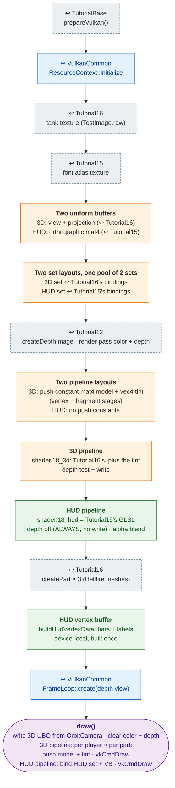

# Tutorial18 — Player tanks and HUD

[Index](../vulkan_pipeline_breakdown.md) · Builds on:
[Tutorial16](16_tank.md) (3D) and [Tutorial15](15_text_and_button.md)
(HUD) · Next: [Tutorial19](19_weapons_projectiles.md)

Two Hellfire tanks, each tinted with a team color, plus a HUD overlay with
vulkan_earth's health and power bars. The first tutorial with two
pipelines in one render pass: a depth-tested 3D pass, then a 2D overlay
with depth testing off.

**Where the reused boxes come from:**

| Box | Defined in |
|---|---|
| prepareVulkan() | [TutorialBase](tutorialbase.md) |
| ResourceContext::initialize | [VulkanCommon](vulkancommon.md) |
| FrameLoop::create(depth view) | [VulkanCommon](vulkancommon.md) |
| tank texture (TestImage.raw) | [Tutorial16](16_tank.md) |
| font atlas texture | [Tutorial15](15_text_and_button.md) |
| createDepthImage · render pass color + depth | [Tutorial12](12_generated_terrain.md) |
| createPart × 3 (Hellfire meshes) | [Tutorial16](16_tank.md) |

## What's new

- Two pipelines and two pipeline layouts in one render pass, switched
  mid-frame.
- A depth-disabled overlay pipeline (`DepthState{false, false, ALWAYS}`)
  drawn after the 3D pass.
- A push constant used by both shader stages (model for the vertex
  stage, tint for the fragment stage).
- HUD bar colors from `UiGeometry::healthBarColor()` /
  `powerBarColor()`, shared with vulkan_earth.

Source: `bin/18_player_tanks_hud/Tutorial18.cpp`
