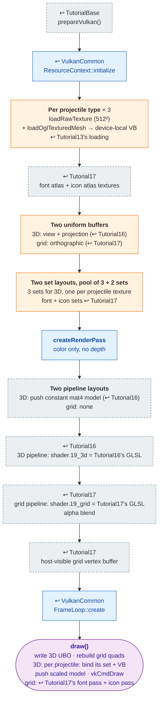

# Tutorial19 — Weapons and projectiles

[Index](../vulkan_pipeline_breakdown.md) · Builds on:
[Tutorial16](16_tank.md) (3D), [Tutorial17](17_item_inventory.md)
(grid), and [Tutorial18](18_player_tanks_hud.md) (two pipelines) · Next:
[Tutorial20](20_particle_effects.md)

vulkan_earth's three projectile meshes (Default, Acid, BFB), each with its
own texture and scale, above a 5×2 weapon grid that mirrors Tutorial17's
item grid.

**Where the reused boxes come from:**

| Box | Defined in |
|---|---|
| prepareVulkan() | [TutorialBase](tutorialbase.md) |
| ResourceContext::initialize | [VulkanCommon](vulkancommon.md) |
| createRenderPass | [VulkanCommon](vulkancommon.md) |
| FrameLoop::create | [VulkanCommon](vulkancommon.md) |
| Per projectile type × 3 | [Tutorial13](13_projectile_model.md) |
| font atlas + icon atlas textures | [Tutorial17](17_item_inventory.md) |
| Two pipeline layouts | [Tutorial16](16_tank.md) |
| 3D pipeline: shader.19_3d = Tutorial16's GLSL | [Tutorial16](16_tank.md) |
| grid pipeline: shader.19_grid = Tutorial17's GLSL | [Tutorial17](17_item_inventory.md) |
| host-visible grid vertex buffer | [Tutorial17](17_item_inventory.md) |

Also builds on: [Tutorial18](18_player_tanks_hud.md).

## What's new

- N descriptor sets from one layout, one per texture, rebound per draw.
  Tutorial17 used two; this uses three for the 3D pass alone.
- Two pipelines in one pass with **no** depth buffer: the three meshes
  never overlap, so none is needed.
- Weapon data and projectile scale from `GameCatalog`.

Source: `bin/19_weapons_projectiles/Tutorial19.cpp`
