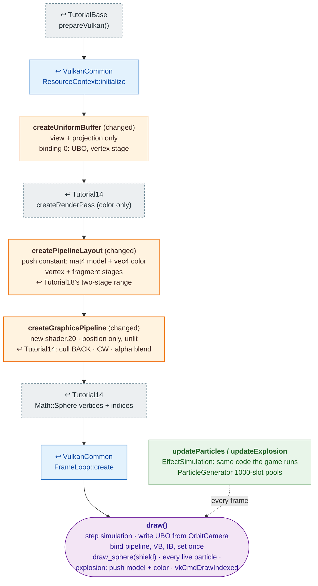

# Tutorial20 — Particle effects

[Index](../vulkan_pipeline_breakdown.md) · Builds on:
[Tutorial14](14_particle_sphere.md) and
[Tutorial16](16_tank.md)'s per-draw push constants · Next:
[Tutorial21](21_world_scene.md)

vulkan_earth's real effects: three particle emitters (smoke, acid, float),
a growing and fading explosion, and the translucent shield. All of them
are one shared sphere mesh, drawn once per instance with its own model
matrix and color pushed as constants. The first tutorial with no texture
at all and a simulation that changes every frame.

**Where the reused boxes come from:**

| Box | Defined in |
|---|---|
| prepareVulkan() | [TutorialBase](tutorialbase.md) |
| ResourceContext::initialize | [VulkanCommon](vulkancommon.md) |
| FrameLoop::create | [VulkanCommon](vulkancommon.md) |
| createRenderPass (color only) | [Tutorial14](14_particle_sphere.md) |
| createPipelineLayout | [Tutorial18](18_player_tanks_hud.md) |
| createGraphicsPipeline | [Tutorial14](14_particle_sphere.md) |
| Math::Sphere vertices + indices | [Tutorial14](14_particle_sphere.md) |

Also builds on: [Tutorial16](16_tank.md).

## What's new

- Many instances of one mesh, each from a push constant. No per-instance
  buffers.
- CPU-side simulation (`EffectSimulation`) driving positions and colors
  every frame, independent of input.

Source: `bin/20_particle_effects/Tutorial20.cpp`
