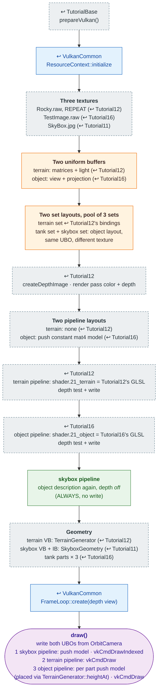

# Tutorial21 — World scene

[Index](../vulkan_pipeline_breakdown.md) · Builds on:
[Tutorial11](11_skybox.md) (skybox), [Tutorial12](12_generated_terrain.md)
(terrain), and [Tutorial16](16_tank.md) (tank) · Next:
[Tutorial22](22_menu_tank_preview.md)

vulkan_earth's `GameState::draw()` order in one scene: skybox, then
terrain, then a tank placed on the terrain at the height the generator
reports. Three pipelines share one render pass and one depth buffer.

**Where the reused boxes come from:**

| Box | Defined in |
|---|---|
| prepareVulkan() | [TutorialBase](tutorialbase.md) |
| ResourceContext::initialize | [VulkanCommon](vulkancommon.md) |
| FrameLoop::create(depth view) | [VulkanCommon](vulkancommon.md) |
| createDepthImage · render pass color + depth | [Tutorial12](12_generated_terrain.md) |
| terrain pipeline: shader.21_terrain = Tutorial12's GLSL | [Tutorial12](12_generated_terrain.md) |
| object pipeline: shader.21_object = Tutorial16's GLSL | [Tutorial16](16_tank.md) |
| Three textures | [Tutorial11](11_skybox.md) |
| Geometry | [Tutorial12](12_generated_terrain.md) |

## What's new

- Three pipelines in one render pass with a shared depth buffer.
- The skybox reuses the object pipeline's description with depth testing
  turned off. At this world scale its far corners sat close enough to the
  far plane that depth tests failed intermittently.
- One object's placement comes from another's data: the tank's height is
  a `TerrainGenerator::heightAt()` query.

Source: `bin/21_world_scene/Tutorial21.cpp`
