# Tutorial21 — World scene

[Index](../vulkan_pipeline_breakdown.md) · Builds on:
[Tutorial11](11_skybox.md) (skybox), [Tutorial12](12_generated_terrain.md)
(terrain), and [Tutorial16](16_tank.md) (tank) · Next:
[Tutorial22](22_menu_tank_preview.md)

vulkan_earth's `GameState::draw()` order in one scene: skybox, then
terrain, then a tank placed on the terrain at the height the generator
reports. Three pipelines share one render pass and one depth buffer.

```mermaid
%%{init: {"flowchart": {"wrappingWidth": 400}}}%%
flowchart TD
    classDef reused fill:#eceff1,stroke:#607d8b,stroke-dasharray:4 3,color:#263238
    classDef changed fill:#fff3e0,stroke:#ef6c00,color:#3e2723
    classDef new fill:#e8f5e9,stroke:#2e7d32,color:#1b5e20
    classDef shared fill:#e3f2fd,stroke:#1565c0,color:#0d47a1
    classDef frame fill:#f3e5f5,stroke:#6a1b9a,color:#311b92

    BASE["↩ TutorialBase<br/><b>prepareVulkan()</b>"]:::reused
    RC["↩ VulkanCommon<br/><b>ResourceContext::initialize</b>"]:::shared
    TEX["<b>three textures</b><br/>vkCreateImage  ·  vkAllocateMemory<br/>vkBindImageMemory  ·  vkCreateImageView<br/>vkCreateSampler  ·  vkCmdPipelineBarrier<br/>vkCmdCopyBufferToImage  ·  vkQueueSubmit"]:::reused
    UBO["<b>createUniformBuffer × 2</b><br/>vkCreateBuffer  ·  vkAllocateMemory<br/>vkBindBufferMemory  ·  vkMapMemory<br/>vkUnmapMemory"]:::changed
    DESC["<b>Descriptors (2 layouts, 3 sets)</b><br/>vkCreateDescriptorSetLayout  ·  vkCreateDescriptorPool<br/>vkAllocateDescriptorSets  ·  vkUpdateDescriptorSets"]:::changed
    DEPTH["↩ Tutorial12<br/><b>createDepthImage · createRenderPass</b><br/>vkCreateImage  ·  vkAllocateMemory<br/>vkBindImageMemory  ·  vkCreateImageView<br/>vkCreateRenderPass"]:::reused
    PLL["<b>createPipelineLayout × 2</b><br/>vkCreatePipelineLayout"]:::reused
    PTER["↩ Tutorial12<br/><b>terrain pipeline</b><br/>vkCreateShaderModule  ·  vkCreateGraphicsPipelines"]:::reused
    POBJ["↩ Tutorial16<br/><b>object pipeline</b><br/>vkCreateShaderModule  ·  vkCreateGraphicsPipelines"]:::reused
    PSKY["<b>skybox pipeline</b><br/>vkCreateGraphicsPipelines"]:::new
    GEO["<b>terrain, skybox, and tank buffers</b><br/>vkCreateBuffer  ·  vkAllocateMemory<br/>vkBindBufferMemory  ·  vkMapMemory<br/>vkCmdCopyBuffer  ·  vkQueueSubmit"]:::reused
    FL["↩ VulkanCommon<br/><b>FrameLoop::create(depth view)</b><br/>vkCreateCommandPool  ·  vkAllocateCommandBuffers<br/>vkCreateSemaphore  ·  vkCreateFence<br/>vkCreateFramebuffer"]:::shared
    DRAW(["<b>draw() → FrameLoop::draw</b><br/>vkDeviceWaitIdle  ·  vkMapMemory<br/>vkCmdBindPipeline  ·  vkCmdBindDescriptorSets<br/>vkCmdBindVertexBuffers  ·  vkCmdBindIndexBuffer<br/>vkCmdPushConstants  ·  vkCmdDrawIndexed<br/>vkCmdDraw"]):::frame

    BASE --> RC --> TEX --> UBO --> DESC --> DEPTH --> PLL --> PTER --> POBJ --> PSKY --> GEO --> FL --> DRAW
```

| Step | From | Vulkan calls |
|---|---|---|
| **prepareVulkan()** | [TutorialBase](tutorialbase.md) | — |
| **ResourceContext::initialize** | [VulkanCommon](vulkancommon.md) | — |
| **three textures** | [Tutorial11](11_skybox.md) | [vkCreateImage](https://registry.khronos.org/vulkan/specs/latest/man/html/vkCreateImage.html), [vkAllocateMemory](https://registry.khronos.org/vulkan/specs/latest/man/html/vkAllocateMemory.html), [vkBindImageMemory](https://registry.khronos.org/vulkan/specs/latest/man/html/vkBindImageMemory.html), [vkCreateImageView](https://registry.khronos.org/vulkan/specs/latest/man/html/vkCreateImageView.html), [vkCreateSampler](https://registry.khronos.org/vulkan/specs/latest/man/html/vkCreateSampler.html), [vkCmdPipelineBarrier](https://registry.khronos.org/vulkan/specs/latest/man/html/vkCmdPipelineBarrier.html), [vkCmdCopyBufferToImage](https://registry.khronos.org/vulkan/specs/latest/man/html/vkCmdCopyBufferToImage.html), [vkQueueSubmit](https://registry.khronos.org/vulkan/specs/latest/man/html/vkQueueSubmit.html) |
| **createUniformBuffer × 2** | changed here | [vkCreateBuffer](https://registry.khronos.org/vulkan/specs/latest/man/html/vkCreateBuffer.html), [vkAllocateMemory](https://registry.khronos.org/vulkan/specs/latest/man/html/vkAllocateMemory.html), [vkBindBufferMemory](https://registry.khronos.org/vulkan/specs/latest/man/html/vkBindBufferMemory.html), [vkMapMemory](https://registry.khronos.org/vulkan/specs/latest/man/html/vkMapMemory.html), [vkUnmapMemory](https://registry.khronos.org/vulkan/specs/latest/man/html/vkUnmapMemory.html) |
| **Descriptors (2 layouts, 3 sets)** | changed here | [vkCreateDescriptorSetLayout](https://registry.khronos.org/vulkan/specs/latest/man/html/vkCreateDescriptorSetLayout.html), [vkCreateDescriptorPool](https://registry.khronos.org/vulkan/specs/latest/man/html/vkCreateDescriptorPool.html), [vkAllocateDescriptorSets](https://registry.khronos.org/vulkan/specs/latest/man/html/vkAllocateDescriptorSets.html), [vkUpdateDescriptorSets](https://registry.khronos.org/vulkan/specs/latest/man/html/vkUpdateDescriptorSets.html) |
| **createDepthImage · createRenderPass** | [Tutorial12](12_generated_terrain.md) | [vkCreateImage](https://registry.khronos.org/vulkan/specs/latest/man/html/vkCreateImage.html), [vkAllocateMemory](https://registry.khronos.org/vulkan/specs/latest/man/html/vkAllocateMemory.html), [vkBindImageMemory](https://registry.khronos.org/vulkan/specs/latest/man/html/vkBindImageMemory.html), [vkCreateImageView](https://registry.khronos.org/vulkan/specs/latest/man/html/vkCreateImageView.html), [vkCreateRenderPass](https://registry.khronos.org/vulkan/specs/latest/man/html/vkCreateRenderPass.html) |
| **createPipelineLayout × 2** | reused | [vkCreatePipelineLayout](https://registry.khronos.org/vulkan/specs/latest/man/html/vkCreatePipelineLayout.html) |
| **terrain pipeline** | [Tutorial12](12_generated_terrain.md) | [vkCreateShaderModule](https://registry.khronos.org/vulkan/specs/latest/man/html/vkCreateShaderModule.html), [vkCreateGraphicsPipelines](https://registry.khronos.org/vulkan/specs/latest/man/html/vkCreateGraphicsPipelines.html) |
| **object pipeline** | [Tutorial16](16_tank.md) | [vkCreateShaderModule](https://registry.khronos.org/vulkan/specs/latest/man/html/vkCreateShaderModule.html), [vkCreateGraphicsPipelines](https://registry.khronos.org/vulkan/specs/latest/man/html/vkCreateGraphicsPipelines.html) |
| **skybox pipeline** | new here | [vkCreateGraphicsPipelines](https://registry.khronos.org/vulkan/specs/latest/man/html/vkCreateGraphicsPipelines.html) |
| **terrain, skybox, and tank buffers** | [Tutorial12](12_generated_terrain.md) | [vkCreateBuffer](https://registry.khronos.org/vulkan/specs/latest/man/html/vkCreateBuffer.html), [vkAllocateMemory](https://registry.khronos.org/vulkan/specs/latest/man/html/vkAllocateMemory.html), [vkBindBufferMemory](https://registry.khronos.org/vulkan/specs/latest/man/html/vkBindBufferMemory.html), [vkMapMemory](https://registry.khronos.org/vulkan/specs/latest/man/html/vkMapMemory.html), [vkCmdCopyBuffer](https://registry.khronos.org/vulkan/specs/latest/man/html/vkCmdCopyBuffer.html), [vkQueueSubmit](https://registry.khronos.org/vulkan/specs/latest/man/html/vkQueueSubmit.html) |
| **FrameLoop::create(depth view)** | [VulkanCommon](vulkancommon.md) | [vkCreateCommandPool](https://registry.khronos.org/vulkan/specs/latest/man/html/vkCreateCommandPool.html), [vkAllocateCommandBuffers](https://registry.khronos.org/vulkan/specs/latest/man/html/vkAllocateCommandBuffers.html), [vkCreateSemaphore](https://registry.khronos.org/vulkan/specs/latest/man/html/vkCreateSemaphore.html), [vkCreateFence](https://registry.khronos.org/vulkan/specs/latest/man/html/vkCreateFence.html), [vkCreateFramebuffer](https://registry.khronos.org/vulkan/specs/latest/man/html/vkCreateFramebuffer.html) |
| **draw() → FrameLoop::draw** | this tutorial | [vkDeviceWaitIdle](https://registry.khronos.org/vulkan/specs/latest/man/html/vkDeviceWaitIdle.html), [vkMapMemory](https://registry.khronos.org/vulkan/specs/latest/man/html/vkMapMemory.html), [vkCmdBindPipeline](https://registry.khronos.org/vulkan/specs/latest/man/html/vkCmdBindPipeline.html), [vkCmdBindDescriptorSets](https://registry.khronos.org/vulkan/specs/latest/man/html/vkCmdBindDescriptorSets.html), [vkCmdBindVertexBuffers](https://registry.khronos.org/vulkan/specs/latest/man/html/vkCmdBindVertexBuffers.html), [vkCmdBindIndexBuffer](https://registry.khronos.org/vulkan/specs/latest/man/html/vkCmdBindIndexBuffer.html), [vkCmdPushConstants](https://registry.khronos.org/vulkan/specs/latest/man/html/vkCmdPushConstants.html), [vkCmdDrawIndexed](https://registry.khronos.org/vulkan/specs/latest/man/html/vkCmdDrawIndexed.html), [vkCmdDraw](https://registry.khronos.org/vulkan/specs/latest/man/html/vkCmdDraw.html) |

## What's new

- Three pipelines in one render pass with a shared depth buffer.
- The skybox reuses the object pipeline's description with depth testing
  turned off. At this world scale its far corners sat close enough to the
  far plane that depth tests failed intermittently.
- One object's placement comes from another's data: the tank's height is
  a `TerrainGenerator::heightAt()` query.

Source: `bin/21_world_scene/Tutorial21.cpp`
