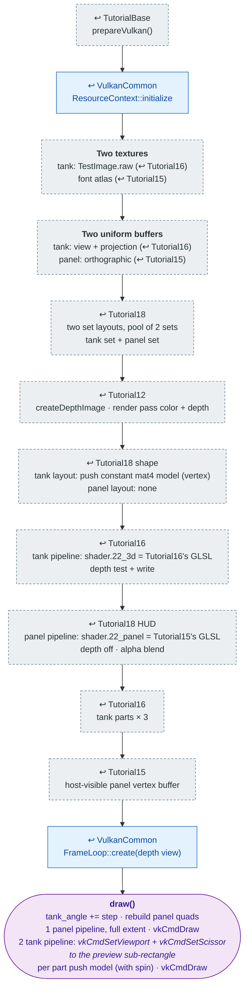

# Tutorial22 — Menu with a tank preview

[Index](../vulkan_pipeline_breakdown.md) · Builds on:
[Tutorial15](15_text_and_button.md) (panel), [Tutorial16](16_tank.md)
(tank), and [Tutorial18](18_player_tanks_hud.md) (two pipelines) ·
Next: none (last tutorial)

vulkan_earth's `ReadyMenu` technique: a bevel-panel menu with a live,
spinning 3D tank rendered into a scissored sub-region of the screen.

**Linked steps:** [TutorialBase](tutorialbase.md);
[VulkanCommon](vulkancommon.md); [Tutorial12](12_generated_terrain.md)
(depth); [Tutorial15](15_text_and_button.md) (font, panel shaders,
per-frame vertex buffer); [Tutorial16](16_tank.md) (tank texture,
pipeline, parts); [Tutorial18](18_player_tanks_hud.md) (two layouts, two
pipelines, depth-off overlay).

## What's new

Almost every setup box is grey. The one new technique is in `draw()`:

- Setting the dynamic viewport and scissor to a sub-rectangle before the
  tank's draws, so the 3D pass renders into part of the frame. Every
  earlier draw used the full-extent viewport `FrameLoop::begin()` sets.
- A transform that animates on its own (`tank_angle` grows every frame),
  sent through the push constant rather than the uniform buffer.

Source: `bin/22_menu_tank_preview/Tutorial22.cpp`
