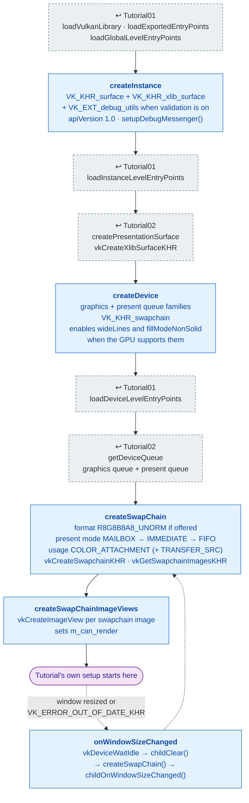

# Shared: `TutorialBase` bring-up

[Index](../vulkan_pipeline_breakdown.md) · Used by Tutorial03–22 (and the
`vulkan_earth` game)

`TutorialBase::prepareVulkan()` (`lib/TutorialBase.cpp`) is the device and
swapchain setup that [Tutorial01](01_device_initialization.md) and
[Tutorial02](02_swap_chain.md) spell out inline. Every later tutorial calls
it first and starts its own pipeline work after it returns.

**Linked steps:** library and entry-point loading come from
[Tutorial01](01_device_initialization.md); the surface and the two queues
come from [Tutorial02](02_swap_chain.md).

## What the base adds over Tutorial02

- **Swapchain image views.** Tutorial02 only clears swapchain images with
  transfer commands, so it never makes views. Framebuffers need them, so
  the base creates one per image.
- **No sync objects.** Semaphores, fences, and command buffers are left to
  each tutorial (Tutorial03–10) or to
  [`FrameLoop`](vulkancommon.md) (Tutorial11–22).
- **Resize protocol.** A tutorial overrides `childClear()` (destroy
  everything that depends on the swapchain) and `childOnWindowSizeChanged()`
  (build it again). The base recreates the swapchain in between, passing
  the old one as `oldSwapchain`.

## Spec links

[`vkCreateInstance`](https://registry.khronos.org/vulkan/specs/latest/man/html/vkCreateInstance.html) ·
[`vkCreateXlibSurfaceKHR`](https://registry.khronos.org/vulkan/specs/latest/man/html/vkCreateXlibSurfaceKHR.html) ·
[`vkCreateDevice`](https://registry.khronos.org/vulkan/specs/latest/man/html/vkCreateDevice.html) ·
[`vkCreateSwapchainKHR`](https://registry.khronos.org/vulkan/specs/latest/man/html/vkCreateSwapchainKHR.html) ·
[`vkCreateImageView`](https://registry.khronos.org/vulkan/specs/latest/man/html/vkCreateImageView.html)
