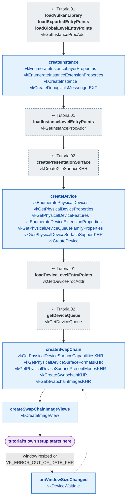

# Shared: `TutorialBase` bring-up

[Index](../vulkan_pipeline_breakdown.md) · Used by Tutorial03–22 (and the
`vulkan_earth` game)

`TutorialBase::prepareVulkan()` (`lib/TutorialBase.cpp`) is the device and
swapchain setup that [Tutorial01](01_device_initialization.md) and
[Tutorial02](02_swap_chain.md) spell out inline. Every later tutorial calls
it first and starts its own pipeline work after it returns.

| Step | From | Vulkan calls |
|---|---|---|
| **loadVulkanLibrary · loadExportedEntryPoints · loadGlobalLevelEntryPoints** | [Tutorial01](01_device_initialization.md) | [vkGetInstanceProcAddr](https://registry.khronos.org/vulkan/specs/latest/man/html/vkGetInstanceProcAddr.html) |
| **createInstance** | shared library | [vkEnumerateInstanceLayerProperties](https://registry.khronos.org/vulkan/specs/latest/man/html/vkEnumerateInstanceLayerProperties.html), [vkEnumerateInstanceExtensionProperties](https://registry.khronos.org/vulkan/specs/latest/man/html/vkEnumerateInstanceExtensionProperties.html), [vkCreateInstance](https://registry.khronos.org/vulkan/specs/latest/man/html/vkCreateInstance.html), [vkCreateDebugUtilsMessengerEXT](https://registry.khronos.org/vulkan/specs/latest/man/html/vkCreateDebugUtilsMessengerEXT.html) |
| **loadInstanceLevelEntryPoints** | [Tutorial01](01_device_initialization.md) | [vkGetInstanceProcAddr](https://registry.khronos.org/vulkan/specs/latest/man/html/vkGetInstanceProcAddr.html) |
| **createPresentationSurface** | [Tutorial02](02_swap_chain.md) | [vkCreateXlibSurfaceKHR](https://registry.khronos.org/vulkan/specs/latest/man/html/vkCreateXlibSurfaceKHR.html) |
| **createDevice** | shared library | [vkEnumeratePhysicalDevices](https://registry.khronos.org/vulkan/specs/latest/man/html/vkEnumeratePhysicalDevices.html), [vkGetPhysicalDeviceProperties](https://registry.khronos.org/vulkan/specs/latest/man/html/vkGetPhysicalDeviceProperties.html), [vkGetPhysicalDeviceFeatures](https://registry.khronos.org/vulkan/specs/latest/man/html/vkGetPhysicalDeviceFeatures.html), [vkEnumerateDeviceExtensionProperties](https://registry.khronos.org/vulkan/specs/latest/man/html/vkEnumerateDeviceExtensionProperties.html), [vkGetPhysicalDeviceQueueFamilyProperties](https://registry.khronos.org/vulkan/specs/latest/man/html/vkGetPhysicalDeviceQueueFamilyProperties.html), [vkGetPhysicalDeviceSurfaceSupportKHR](https://registry.khronos.org/vulkan/specs/latest/man/html/vkGetPhysicalDeviceSurfaceSupportKHR.html), [vkCreateDevice](https://registry.khronos.org/vulkan/specs/latest/man/html/vkCreateDevice.html) |
| **loadDeviceLevelEntryPoints** | [Tutorial01](01_device_initialization.md) | [vkGetDeviceProcAddr](https://registry.khronos.org/vulkan/specs/latest/man/html/vkGetDeviceProcAddr.html) |
| **getDeviceQueue** | [Tutorial02](02_swap_chain.md) | [vkGetDeviceQueue](https://registry.khronos.org/vulkan/specs/latest/man/html/vkGetDeviceQueue.html) |
| **createSwapChain** | shared library | [vkGetPhysicalDeviceSurfaceCapabilitiesKHR](https://registry.khronos.org/vulkan/specs/latest/man/html/vkGetPhysicalDeviceSurfaceCapabilitiesKHR.html), [vkGetPhysicalDeviceSurfaceFormatsKHR](https://registry.khronos.org/vulkan/specs/latest/man/html/vkGetPhysicalDeviceSurfaceFormatsKHR.html), [vkGetPhysicalDeviceSurfacePresentModesKHR](https://registry.khronos.org/vulkan/specs/latest/man/html/vkGetPhysicalDeviceSurfacePresentModesKHR.html), [vkCreateSwapchainKHR](https://registry.khronos.org/vulkan/specs/latest/man/html/vkCreateSwapchainKHR.html), [vkGetSwapchainImagesKHR](https://registry.khronos.org/vulkan/specs/latest/man/html/vkGetSwapchainImagesKHR.html) |
| **createSwapChainImageViews** | shared library | [vkCreateImageView](https://registry.khronos.org/vulkan/specs/latest/man/html/vkCreateImageView.html) |
| **tutorial's own setup starts here** | this tutorial | — |
| **onWindowSizeChanged** | shared library | [vkDeviceWaitIdle](https://registry.khronos.org/vulkan/specs/latest/man/html/vkDeviceWaitIdle.html) |

## What the base adds over Tutorial02

- **Swapchain image views.** Tutorial02 only clears swapchain images with
  transfer commands, so it never makes views. Framebuffers need them, so
  the base creates one per image.
- **No sync objects.** Semaphores, fences, and command buffers are left to
  each tutorial (Tutorial03–10) or to
  [`FrameLoop`](vulkancommon.md) (Tutorial11–22).
- **Resize protocol.** A tutorial overrides `childClear()` (destroy
  everything that depends on the swapchain) and `childOnWindowSizeChanged()`
  (build it again). The base recreates the swapchain in between, passing
  the old one as `oldSwapchain`.

