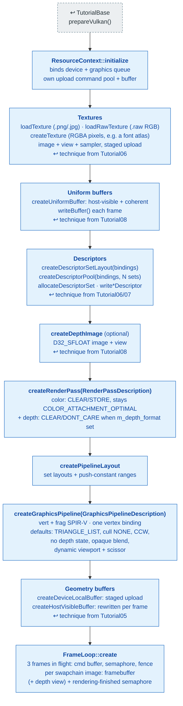
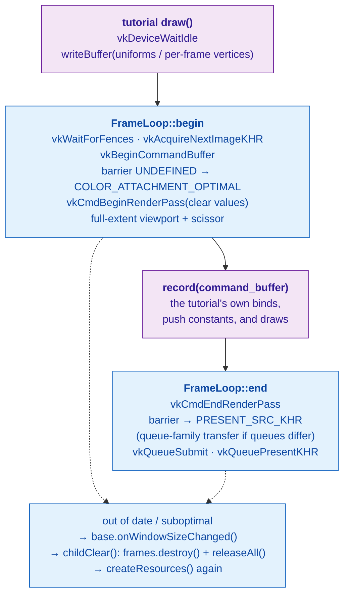

# Shared: `VulkanCommon` renderer scaffolding

[Index](../vulkan_pipeline_breakdown.md) · Used by Tutorial11–22 (and
`Render::Renderer`)

Tutorial03–10 write every Vulkan object out by hand. Tutorial11–22 build
the same objects through `include/vulkan_graphix/VulkanCommon/`, so each of
those pages shows only what is specific to that tutorial. This page is
what the boxes marked **ResourceContext** and **FrameLoop** stand for.

## Setup: `createResources()`

Every Tutorial11–22 `createResources()` follows this order. Each tutorial
page fills in its own textures, bindings, pipelines, and buffers.

**Linked steps:** [TutorialBase](tutorialbase.md). The techniques each
helper wraps were introduced in
[Tutorial05](05_staging_resources.md) (staging),
[Tutorial06](06_descriptor_sets.md) (textures, descriptors),
[Tutorial07](07_uniform_buffers.md) (uniform binding), and
[Tutorial08](08_phong_sphere.md) (depth, host-visible uniforms).

## Per frame: `draw()` through `FrameLoop::draw()`

## Teardown

`childClear()` is two lines in every Tutorial11–22:
`m_frames.destroy(); m_resources.releaseAll();`. `releaseAll()` waits for
the device to go idle, then destroys everything the context created,
newest first.
