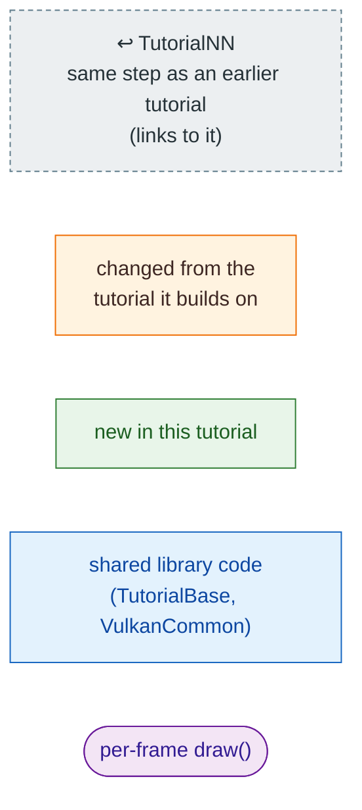
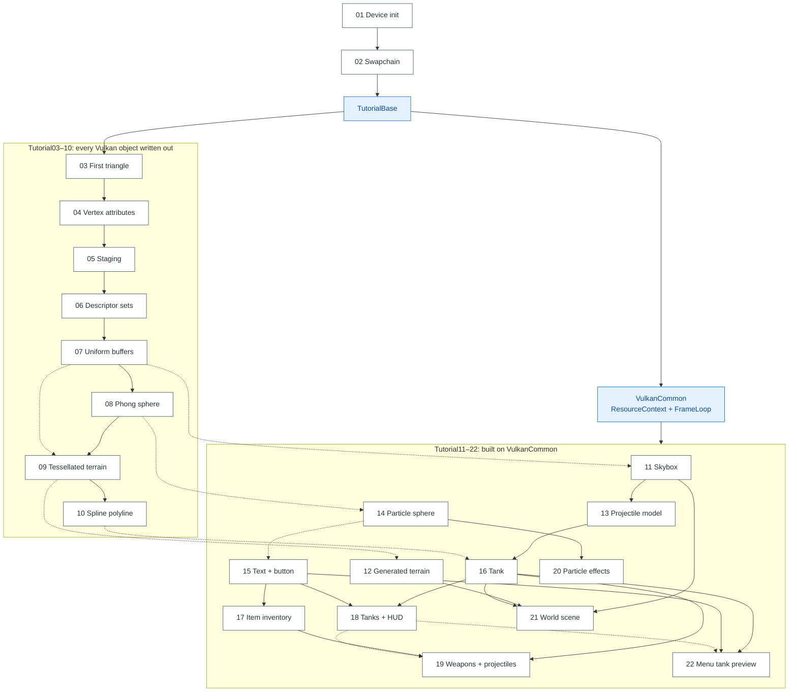

# Vulkan pipeline setup, tutorial by tutorial

Each tutorial has its own page under [`pipeline/`](pipeline/) with one
Mermaid diagram of its setup, in the order the code runs it, followed by
its per-frame `draw()`. A step a tutorial takes unchanged from an earlier
one is a grey dashed box naming that tutorial and linking to its page,
so each page shows in color only what that tutorial adds or changes.

## Legend

Boxes that point at another page carry a Mermaid `click` link. Not every
Markdown viewer follows those, so every page also lists the same links as
plain Markdown under its diagram.

## How the tutorials build on each other

Solid arrows: the tutorial is a modified copy of the one it points from.
Dotted arrows: it borrows one technique or shader from it.

## Pages

| Page | Builds on | What it adds |
|---|---|---|
| [TutorialBase](pipeline/tutorialbase.md) | 01, 02 | Shared device + swapchain bring-up, image views, resize protocol |
| [01 Device initialization](pipeline/01_device_initialization.md) | — | Loader, instance, logical device, one queue |
| [02 Swap chain](pipeline/02_swap_chain.md) | 01 | Surface, present queue, swapchain, clear via `vkCmdClearColorImage` |
| [03 First triangle](pipeline/03_first_triangle.md) | TutorialBase | Render pass, framebuffers, shaders, first pipeline |
| [04 Vertex attributes](pipeline/04_vertex_attributes.md) | 03 | Host-visible vertex buffer, 3 frames in flight, dynamic viewport |
| [05 Staging resources](pipeline/05_staging_resources.md) | 04 | Device-local vertex buffer through a staging copy |
| [06 Descriptor sets](pipeline/06_descriptor_sets.md) | 05 | Texture + sampler, descriptor sets, per-frame layout barriers |
| [07 Uniform buffers](pipeline/07_uniform_buffers.md) | 06 | Uniform buffer, orthographic projection |
| [08 Phong sphere](pipeline/08_phong_sphere.md) | 07 | Depth buffer, index buffer, per-frame host-visible uniforms |
| [09 Tessellated terrain](pipeline/09_tessellated_terrain.md) | 08 (+07) | Texture with REPEAT, cull NONE, orbit camera |
| [10 Spline polyline](pipeline/10_spline_polyline.md) | 09 | Line strips, push constants, dynamic line width |
| [VulkanCommon](pipeline/vulkancommon.md) | 05–08 techniques | `ResourceContext` setup, `FrameLoop` per-frame loop |
| [11 Skybox](pipeline/11_skybox.md) | 07 shaders | First library-built tutorial; indexed textured cube |
| [12 Generated terrain](pipeline/12_generated_terrain.md) | 09 shaders | `TerrainGenerator`, depth through `FrameLoop` |
| [13 Projectile model](pipeline/13_projectile_model.md) | 11 | `.ogl` mesh loading |
| [14 Particle sphere](pipeline/14_particle_sphere.md) | 08 | Alpha blending |
| [15 Text and button](pipeline/15_text_and_button.md) | 07, 14 | Font atlas, per-frame host-visible UI vertices |
| [16 Tank](pipeline/16_tank.md) | 13, 10 | Multi-part mesh, model matrix as push constant |
| [17 Item inventory](pipeline/17_item_inventory.md) | 15 | Two descriptor sets from one layout, icon atlas |
| [18 Player tanks + HUD](pipeline/18_player_tanks_hud.md) | 16, 15 | Two pipelines in one pass, depth-off overlay |
| [19 Weapons + projectiles](pipeline/19_weapons_projectiles.md) | 16, 17, 18 | N descriptor sets, one per texture |
| [20 Particle effects](pipeline/20_particle_effects.md) | 14, 16 | Instancing by push constant, live simulation |
| [21 World scene](pipeline/21_world_scene.md) | 11, 12, 16 | Three pipelines, depth-off skybox, height-based placement |
| [22 Menu tank preview](pipeline/22_menu_tank_preview.md) | 15, 16, 18 | Sub-region viewport and scissor |

"Same GLSL" claims on these pages were checked by diffing the shader
sources under `resources/NN/Data/`, ignoring comments and whitespace.
